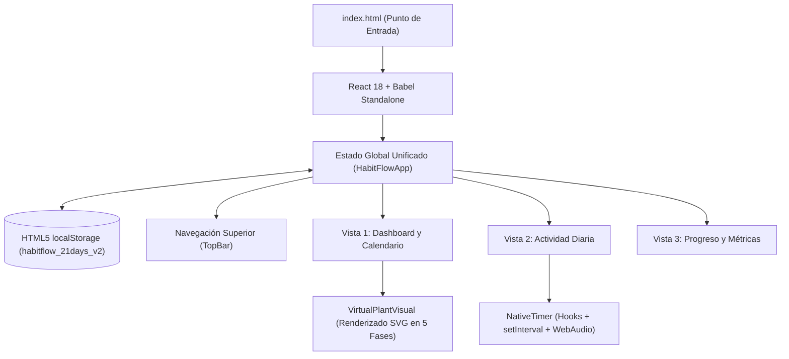

# 🛠️ Documentación Técnica Exhaustiva: Arquitectura y Funcionamiento del Código de HabitFlow

Esta guía técnica explica paso a paso la estructura interna, patrones de diseño, algoritmos matemáticos y el flujo de ejecución de la aplicación web **HabitFlow: Programa de Hábitos de Estudio de 21 Días**.

---

## 🏗️ 1. Arquitectura General y Stack Tecnológico

La aplicación está construida bajo el patrón **SPA (Single Page Application)** monolítica y modular, ejecutada directamente en el cliente (Browser Runtime):



### Tecnologías Empleadas y Justificación:
1. **React 18 (vía CDN UMD):**
   - Utiliza arquitectura orientada a componentes funcionales.
   - Manejo de reactividad con Hooks nativos (`useState`, `useEffect`, `useRef`, `useMemo`).
   - Cero dependencias de empaquetado complejas para que el usuario pueda abrir el archivo directamente con doble clic.
2. **Tailwind CSS (vía CDN Oficial):**
   - Sistema de diseño de clases utilitarias con paleta cromática profesional: *Slate* (sobriedad y neutralidad), *Indigo/Brand* (foco y acción primaria) y *Emerald/Growth* (éxito, progreso y biología).
3. **HTML5 LocalStorage:**
   - Persistencia local inmediata sin requerir bases de datos remotas ni autenticación en la nube, garantizando $100\%$ de privacidad y funcionamiento fuera de línea (*offline*).
4. **Web Audio API:**
   - Síntesis de ondas sonoras en tiempo real con osciladores nativos de JavaScript. Elimina la necesidad de archivos `.mp3` o `.wav` externos y evita fallos de carga o problemas de CORS.
5. **SVG Vectorial Paramétrico:**
   - La planta virtual no es una imagen estática, sino una serie de gráficos vectoriales matemáticos renderizados condicionalmente según la fase actual de crecimiento.

---

## 🗄️ 2. Modelo de Datos y Estructura en `localStorage`

Toda la aplicación sincroniza su estado bajo la clave única `habitflow_21days_v2`:

```json
{
  "activeHabit": "Vencer la procrastinación e iniciar sesiones de estudio efectivas",
  "habitMagnitude": "mediano",
  "completedDays": [1, 2],
  "currentViewingDay": 3,
  "currentView": "activity",
  "dayData": {
    "1": {
      "taskName": "Estudiar Cálculo Diferencial",
      "category": "Escuela",
      "firstAction": "Abrir libreta en derivadas",
      "timerCompleted": true
    },
    "2": {
      "step1": "Revisar formulario",
      "step2": "Resolver problema 1 al 3",
      "step3": "Verificar con soluciones",
      "timerCompleted": true
    }
  },
  "metrics": {
    "focusMinutes": 10,
    "sessionsStarted": 2,
    "sessionsCompleted": 2,
    "tasksRegisteredCount": 1,
    "stepsCompletedCount": 3,
    "punctualityLogs": [
      { "day": 8, "scheduled": "16:00", "actual": "16:04", "isOnTime": true }
    ]
  },
  "featuredNextStep": {
    "step": "Resolver ejercicios impares de derivadas",
    "materials": "Libreta y calculadora",
    "savedAt": "18/11/2026"
  },
  "personalPlan": {
    "strategies": ["Micro-pasos de fricción cero", "Acondicionamiento de espacio"],
    "frequency": "4 días por semana",
    "schedule": "17:00 a 18:00",
    "generatedAt": "18/11/2026"
  }
}
```

### Inicialización y Resiliencia del Estado:
La función `getInitialState()` se ejecuta una sola vez al cargar la aplicación:
```javascript
const getInitialState = () => {
  try {
    const saved = localStorage.getItem(STORAGE_KEY);
    if (saved) return JSON.parse(saved);
  } catch (e) {
    console.error('Error cargando estado:', e);
  }
  return estadoPredeterminado;
};
```
Cada vez que el estado cambia, un efecto secundario lo persiste automáticamente:
```javascript
useEffect(() => {
  localStorage.setItem(STORAGE_KEY, JSON.stringify(appState));
}, [appState]);
```

---

## ⚙️ 3. El Motor de Calibración: Los 3 Calendarios

Para responder a la diferencia cualitativa entre hábitos como *ordenar el cuarto* (físico/rápido) y *estudiar cálculo* (alto esfuerzo cognitivo), el código implementa un **diccionario de calibración** y una función selectora `getDayConfig(dayNum, magnitude)`.

### A. Diccionario de Magnitudes (`HABIT_MAGNITUDES`):
```javascript
const HABIT_MAGNITUDES = {
  chico: {
    name: 'Chico (Baja complejidad / Físico rápido)',
    timeRangeLabel: '2 a 10 minutos por día',
    totalPlannedMinutes: 87
  },
  mediano: {
    name: 'Mediano (Complejidad moderada / Rutina diaria)',
    timeRangeLabel: '5 a 23 minutos por día',
    totalPlannedMinutes: 182
  },
  grande: {
    name: 'Grande (Alta demanda cognitiva / Estudio profundo)',
    timeRangeLabel: '5 a 30 minutos por día',
    totalPlannedMinutes: 257
  }
};
```

### B. Mapeo Dinámico de Duraciones por Día:
En la función `getDayConfig`, las duraciones están mapeadas para cada uno de los 21 días en arreglos indexados:
```javascript
const durations = {
  chico:   [2, 3, 3, 3, 3, 4, 2,  5, 3,  5,  5,  5,  8, 3,  5,  4, 3, 10,  5, 3, 3],
  mediano: [5, 5, 5, 5, 5, 7, 3,  8, 5, 10,  8, 10, 18, 5, 10,  5, 5, 23, 10, 5, 5],
  grande:  [5, 7, 8, 6, 8, 10, 5, 12, 8, 15, 12, 15, 25, 7, 15, 10, 8, 30, 15, 8, 8]
};
```

### C. Secuencias Multi-Bloque Adaptadas (Días 13 y 18):
En los días con estructura guiada de trabajo y descanso intercalado, los bloques se condicionan según la magnitud:
```javascript
const sequences = {
  chico: {
    13: [{ name: 'Acción Rápida', minutes: 4, type: 'work' },
         { name: 'Pausa Breve', minutes: 1, type: 'break' },
         { name: 'Cierre y Orden', minutes: 3, type: 'work' }] // Total: 8 min
  },
  mediano: {
    13: [{ name: 'Trabajo Enfocado', minutes: 10, type: 'work' },
         { name: 'Descanso Activo', minutes: 3, type: 'break' },
         { name: 'Trabajo de Cierre', minutes: 5, type: 'work' }] // Total: 18 min
  },
  grande: {
    13: [{ name: 'Estudio Profundo', minutes: 15, type: 'work' },
         { name: 'Descanso Activo', minutes: 3, type: 'break' },
         { name: 'Consolidación Analítica', minutes: 7, type: 'work' }] // Total: 25 min
  }
};
```

---

## 🔐 4. Lógica de Negocio y Reglas de Bloqueo

### A. Desbloqueo Secuencial Estricto (`isDayLocked`):
Un día $N$ permanece bloqueado con icono de candado hasta que el Día $N-1$ esté en el arreglo `completedDays`:
```javascript
const isDayLocked = (dayNum) => {
  if (dayNum === 1) return false; // Día 1 siempre accesible
  return !appState.completedDays.includes(dayNum - 1);
};
```
Si el usuario intenta hacer clic en un día bloqueado, la interfaz emite un toast de advertencia impidiendo la navegación.

### B. Modo Solo Lectura para Días Completados:
```javascript
const isDayCompleted = (dayNum) => appState.completedDays.includes(dayNum);
const readOnly = isDayCompleted(dayNumber);
```
Cuando `readOnly` es `true`:
- Los campos de texto, selectores y casillas de verificación reciben el atributo `disabled={readOnly}`.
- Se despliega el banner protector: *"Modo de Solo Consulta (Lectura): Tus respuestas están protegidas"*.
- El botón de finalizar es reemplazado por la etiqueta fija: *"Día Finalizado y Protegido ✅"*.

---

## 🧮 5. Algoritmos de Cálculo

### A. Cálculo del Porcentaje Diario (`calculateDayCompletion`):
Cada día define un total de acciones obligatorias $A_{\text{total}}$. La función evalúa el objeto `dayData[dayNumber]` y cuenta cuántas acciones han sido completadas válidamente:

$$\text{Porcentaje Diario} = \text{redondear}\left( \frac{A_{\text{completadas}}}{A_{\text{total}}} \times 100 \right)$$

*Ejemplo en el código para el Día 1 ($A_{\text{total}} = 4$):*
```javascript
let doneActions = 0;
if (data.taskName && data.taskName.trim().length > 1) doneActions++;
if (data.category) doneActions++;
if (data.firstAction && data.firstAction.trim().length > 1) doneActions++;
if (data.timerCompleted) doneActions++;

const percentage = Math.round((doneActions / 4) * 100);
return Math.min(100, percentage);
```

### B. Botón "Finalizar Día" Condicionado:
El botón de guardado en la barra inferior se condiciona directamente al porcentaje:
```jsx
<button
  type="button"
  disabled={dayPercentage < 100}
  onClick={() => onFinalizeDay(dayNumber)}
  className={dayPercentage === 100 ? "bg-growth-500 cursor-pointer animate-pulse" : "bg-slate-200 cursor-not-allowed"}
>
  Finalizar Día {dayNumber} (100%)
</button>
```

### C. Porcentaje Global y Evolución Botánica:
$$\text{Porcentaje Global} = \text{redondear}\left( \frac{\text{Días Completados}}{21} \times 100 \right)$$

La función `getPlantPhase(completedDaysCount)` asigna la etapa botánica en función de los días acumulados:
- **0 a 3 días:** Fase 1 (Semilla Latente / Germinando).
- **4 a 7 días:** Fase 2 (Brote Emergente).
- **8 a 14 días:** Fase 3 (Tallo Firme con Hojas).
- **15 a 20 días:** Fase 4 (Floración Radiante).
- **21 días:** Fase 5 (Árbol Maduro de Estudio).

### D. Medición de Puntualidad Objetiva (Margen de 15 Minutos):
Cuando el usuario define su hora programada de inicio (Día 8, Día 17 o Día 19) y hace clic en *"Registrar Inicio Ahora"*:
$$\text{Diferencia Minutos} = |\text{Minuto Real} - \text{Minuto Programado}|$$
$$\text{Puntual} \iff \text{Diferencia Minutos} \le 15$$
El resultado se guarda en el arreglo `metrics.punctualityLogs`. En la Vista 3, la puntualidad global se calcula como:
```javascript
const punctualityPercentage = Math.round((onTimeCount / totalLogs) * 100);
```

---

## ⏱️ 6. Temporizador Nativo en React (`NativeTimer`)

El componente `NativeTimer` fue implementado con JavaScript nativo sin dependencias externas pesadas, asegurando un ciclo de vida libre de fugas de memoria (*memory leaks*):

### A. Ciclo de Vida y Limpieza:
```javascript
const timerRef = useRef(null);

// Limpieza automática al desmontar el componente
useEffect(() => {
  return () => {
    if (timerRef.current) clearInterval(timerRef.current);
  };
}, []);

// Bucle de cuenta regresiva
useEffect(() => {
  if (isRunning) {
    timerRef.current = setInterval(() => {
      setTimeLeft(prev => {
        if (prev <= 1) {
          // Fase o sesión concluida
          if (soundEnabled) playChime();
          // Avanza de fase o finaliza
          return 0;
        }
        return prev - 1;
      });
    }, 1000);
  } else {
    clearInterval(timerRef.current);
  }
  return () => clearInterval(timerRef.current);
}, [isRunning]);
```

### B. Síntesis Sonora con Web Audio API (`playChime`):
En lugar de cargar un archivo de audio por red, el código genera un acorde de campana sintetizando dos osciladores sinusoidales:
- **Tono 1 (Fundamental):** Frecuencia a $587.33\text{ Hz}$ (nota Re 5).
- **Tono 2 (Armónico brillante):** Frecuencia a $880.00\text{ Hz}$ (nota La 5) con retardo de $150\text{ ms}$.
- **Curva de desvanecimiento:** Exponencial mediante `gain.exponentialRampToValueAtTime`, produciendo un timbre acústico agradable y limpio.

---

## 🌿 7. Renderizado Vectorial de la Planta Virtual (`VirtualPlantVisual`)

El componente recibe la prop `phase` ($1$ a $5$) y utiliza renderizado condicional dentro de un elemento `<svg>` con `viewBox="0 0 240 200"`:
- **Base Común:** Maceta de terracota geométrica (`<path>` trapezoide `#d97706`), borde superior (`<rect>` `#f59e0b`) y plato inferior con elipses de sombra.
- **Fase 1 (Semilla):** Punto central `#fef08a` con aro animado de destellos `strokeDasharray="3 3"` y rotación CSS.
- **Fase 2 (Brote):** Curva de Bézier cuadrática (`<path d="M120 129 Q120 108 120 95">`) de grosor 4 y dos elipses cotiledóneas con gotas de agua.
- **Fase 3 (Tallo con Hojas):** Tallo reforzado con grosor 5 y 6 hojas distribuidas en pares alternados con nervaduras.
- **Fase 4 (Floración):** Ramificaciones densas con capullos y tres flores en tono índigo/violeta (`#6366f1`, `#818cf8`) con pistilos amarillos (`#facc15`) y una mariposa en rotación angular.
- **Fase 5 (Árbol Completo):** Tronco leñoso texturizado en tono roble (`#78350f`), copa densa con 6 círculos de follaje en verde esmeralda, 5 frutos dorados de logro (`#f59e0b`), estrella en la cúspide y mariposas flotantes.

---

## 📊 8. Vista 3: Centro de Auditoría y Métricas Objetivas

La **Vista 3** cumple el principio de verificación objetiva solicitado por el profesor, mostrando métricas basadas en hechos comprobables:
1. **Actividades:** $\text{Días Completados} / 21$.
2. **Tiempo de Enfoque:** Minutos acumulados exclusivamente de temporizadores que llegaron a `00:00`.
3. **Sesiones:** Comparativa de $\text{Iniciadas}$ vs $\text{Terminadas}$ con porcentaje de éxito.
4. **Desglose:** Conteo numérico de tareas principales y micro-pasos registrados.
5. **Puntualidad:** Porcentaje de cumplimiento del horario programado dentro de los 15 minutos.
6. **Exportación JSON:** Genera un archivo descargable con el snapshot completo del estado para respaldo o revisión académica.

---

## 📋 9. Resumen de Archivos del Proyecto

| Archivo | Ubicación | Función Principal |
|:---|:---|:---|
| **`index.html`** | `scratch/habitflow/index.html` | SPA completa con React 18, Tailwind, componentes, vistas y temporizador. |
| **`programDays.js`** | `scratch/habitflow/src/data/programDays.js` | Definición de los 3 calendarios (Chico, Mediano, Grande) y metadatos. |
| **`test_21days.html`** | `scratch/habitflow/test_21days.html` | Suite automatizada de pruebas unitarias para validar las reglas de negocio. |
| **`start_server.ps1`** | `scratch/habitflow/start_server.ps1` | Servidor web HTTP local ligero en PowerShell sobre el puerto 8080. |
| **`iniciar_habitflow.bat`** | `scratch/habitflow/iniciar_habitflow.bat` | Lanzador directo de un clic para abrir la app en Windows. |
| **`GUIA_EXPLICATIVA_PROFESOR.md`** | `scratch/habitflow/GUIA_EXPLICATIVA_PROFESOR.md` | Dossier explicativo para defender el proyecto ante el profesor. |
| **`EXPLICACION_TECNICA_DEL_CODIGO.md`** | `scratch/habitflow/EXPLICACION_TECNICA_DEL_CODIGO.md` | Documentación técnica exhaustiva del código fuente. |
