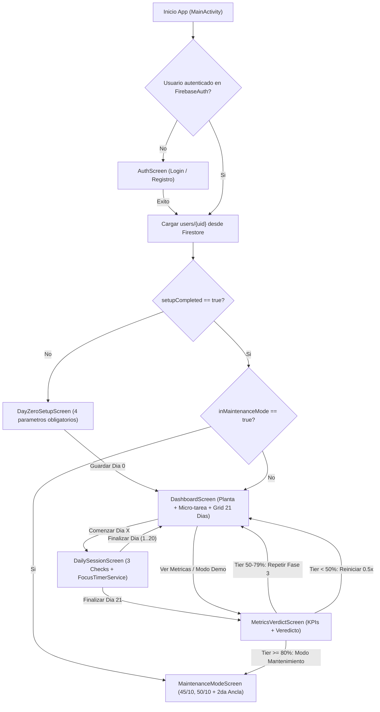

# MATRIZ DE ORQUESTACION: HabitFlow Android (Kotlin + Jetpack Compose + Firebase)

> Documento maestro de ingenieria y orquestacion para generar paso a paso la aplicacion nativa Android de **HabitFlow: Sprint de Condicionamiento Progresivo contra la Procrastinacion (21 Dias)** a partir del PDF semilla `HabitFlow v2 - Especificación Funcional y Prompt para Antigravity`.

---

## Ficha Tecnica y Contrato de Orquestacion

| Atributo | Especificacion Oficial |
| :--- | :--- |
| **Proyecto** | HabitFlow Android |
| **Repositorio Git** | `UTDevs-Software-Team/Habit-Flow` |
| **Application ID / Package** | `com.utdevs.habitflow` (debe coincidir exactamente con la app Android registrada en Firebase) |
| **Proyecto Firebase** | `habit-flow-fb095` |
| **Lenguaje** | 100% Kotlin (prohibido codigo `.java` y Groovy `.gradle`) |
| **Build System** | Gradle Kotlin DSL (`*.gradle.kts`) + Version Catalog (`gradle/libs.versions.toml`) |
| **SDK Android** | `minSdk = 26` (`java.time` nativo sin desugaring), `compileSdk = 37`, `targetSdk = 37` |
| **Capa UI** | Jetpack Compose + Material 3 + Navigation Compose |
| **Arquitectura** | Clean MVVM + Unidirectional Data Flow (`StateFlow` / `SharedFlow`) |
| **Backend & Persistencia** | Firebase Authentication + Cloud Firestore con cache persistente offline activa |
| **Firebase BoM** | `com.google.firebase:firebase-bom:34.18.0` (ultima estable verificada opcional: `35.2.0`) |
| **Ejecucion en Segundo Plano** | `ForegroundService` (`foregroundServiceType="specialUse"`) con `SystemClock.elapsedRealtime()` |

### Reglas No Negociables de Generacion de Codigo

1. **Cero Java:** Todo el codigo fuente, tests, servicios y scripts Gradle deben estar en Kotlin (`.kt` y `.kts`).
2. **Cero sufijos `-ktx` en Firebase:** Desde Firebase BoM `34.0.0`, los artefactos `-ktx` fueron eliminados y absorbidos por los modulos principales. Declarar exclusivamente `com.google.firebase:firebase-auth` y `com.google.firebase:firebase-firestore`.
3. **Corrutinas sobre Callbacks:** Prohibido anidar `.addOnSuccessListener` / `.addOnCompleteListener` dentro de ViewModels o UI. Usar `org.jetbrains.kotlinx:kotlinx-coroutines-play-services` (`.await()`) y `callbackFlow` encapsulados en repositorios.
4. **Aislamiento Multi-Usuario en Firestore:** Prohibido escribir en colecciones raiz planas (`db.collection("habits")`). Todo dato del usuario vive bajo `users/{uid}` protegido por `firestore.rules`.
5. **Cero WebViews y cero `localStorage`:** Toda la logica, cronometros y visualizacion de planta evolutiva son nativos en Kotlin y Jetpack Compose.
6. **Cero Emojis:** Prohibido usar emojis en codigo fuente, textos de UI, logs o comentarios. Usar `Canvas`, iconos `Material Icons` y texto tecnico limpio.
7. **Single Source of Truth de Dominio:** Las reglas de los 21 dias, calculo de bloques, puntualidad, etapas de planta y veredicto viven en casos de uso puros en Kotlin testeables en JVM sin emulador.

---

## Seccion 1: Auditoria Critica de la Semilla y Decisiones Arquitectonicas

Antes de generar la primera linea de codigo, quedan documentadas y resueltas seis fallas criticas detectadas entre el PDF semilla, el repositorio actual y el snippet inicial de Firebase:

### 1.1 Pivote Web SPA a Android Nativo Kotlin + Firebase
- **Hallazgo:** El PDF semilla (Secciones 1, 3 y 5) y el `README.md` actual del repositorio describen una SPA web (`HTML5/CSS3/JS/localStorage`).
- **Decision:** Se reemplaza por completo la capa web y `localStorage` por **Jetpack Compose + Material 3**, **Firebase Authentication** (Correo/Contrasena) y **Cloud Firestore** con persistencia local en disco habilitada (`persistentCacheSettings`). El `README.md` actual no se altera hasta completar la Fase 8.

### 1.2 Contradiccion del Dia 1 en el PDF (5 min vs 10 min)
- **Hallazgo:** La tabla de la Fase 1 (pagina 3 del PDF) indica "10 min seguidos" y "Regla de los 10 minutos" en el Dia 1, mientras que la pagina 1, el criterio de exito ("Completar 5 min sin abrir otra app o pestaña") y el esquema JSON canonico (pagina 8) especifican `"focusMinutes": 5` y `"blocks": [{ "type": "focus", "duration": 5 }]`.
- **Verificacion matematica:**
  - Fase 1 (Dias 1-7): `5 + 10 + 10 + 15 + 15 + 30 + 30 = 115 min`
  - Fase 2 (Dias 8-14): `25 + 25 + 40 + 50 + 50 + 55 + 50 = 295 min`
  - Fase 3 (Dias 15-21): `40 + 40 + 70 + 45 + 80 + 50 + 50 = 375 min`
  - Total: `115 + 295 + 375 = 785 min` (`13.08 horas`), valor exacto exigido por `"totalTargetMinutes": 785`.
- **Decision:** La fuente canonica del Dia 1 es **5 minutos** (`focusMinutes = 5`, 1 bloque `FOCUS` de 5 min). Si se usaran 10 minutos, el acumulado subiria a 790 y romperia la meta oficial de 785 minutos.

### 1.3 Contradiccion Logica entre Desbloqueo Secuencial Estricto y Veredicto (<80%)
- **Hallazgo:** El PDF exige "desbloqueo secuencial estricto" (el Dia N+1 no se abre sin completar el Dia N al 100%) y al mismo tiempo define al cerrar el Dia 21 tres veredictos basados en dias completados: `>= 80%` (17-21 dias), `50%-79%` (11-16 dias) y `< 50%` (0-10 dias). Si fuera imposible avanzar sin completar el dia previo, un usuario jamas podria llegar al Dia 21 con menos de 21 dias completados.
- **Decision:** Se adopta un **Sprint Anclado por Calendario + Bloqueo Estricto Hacia Adelante**:
  - Al finalizar el Dia 0 se fija `sprintStartDate` (`LocalDate` en formato ISO `yyyy-MM-dd`).
  - El dia calendario del sprint es `calendarDayIndex = ChronoUnit.DAYS.between(sprintStartDate, today) + 1` (acotado a `1..21`).
  - **Regla de estado por dia (`DayStatus`):**
    - `COMPLETED`: El usuario completo los 3 checks obligatorios y pulso "Finalizar Dia".
    - `ACTIVE`: Es el dia en curso (`day == currentUnlockedDay`) disponible para ejecutarse. No se pueden adelantar dias futuros (`day > calendarDayIndex` o posteriores al dia activo).
    - `MISSED`: El dia vencio sin completarse (al avanzar de fecha sin cerrar el dia, o al marcar "Omitir dia" en Modo Demo). Cuenta como `0` en `completedDays` y avanza el puntero para no estancar el sprint de 21 dias.
    - `LOCKED`: Dia futuro que aun no corresponde al progreso actual.
  - Al completar o alcanzar el cierre del Dia 21, `completedDays.size` refleja el cumplimiento real entre `0` y `21`, permitiendo disparar los tres veredictos de forma autentica.

### 1.4 Vulnerabilidad Critica del Snippet `db.collection("habits")` Plano
- **Hallazgo:** El ejemplo de entrada usa `db.collection("habits").add(...)` en una coleccion raiz sin asociar el `uid` de Firebase Auth y sugiere dejar Firestore en "modo de prueba" durante el desarrollo.
- **Decision:** En Android multi-usuario esto mezcla los datos de todos los usuarios y expone la base de datos a lectura/escritura publica. Toda escritura y lectura se estructura bajo `users/{uid}/...` y se definen `firestore.rules` estrictas desde la Fase 2. El Modo de Prueba de la consola solo se tolera en la Fase 0 inicial y debe sustituirse antes de cerrar la Fase 2 / Fase 8.

### 1.5 Firebase BoM `34.18.0`, Eliminacion de `-ktx` y Corrutinas
- **Hallazgo:** El usuario especifico `com.google.firebase:firebase-bom:34.18.0` con `firebase-auth` y `firebase-firestore`. Desde BoM `34.0.0`, Google elimino los modulos `-ktx` y movio las APIs Kotlin al artefacto principal. Asimismo, las llamadas asincronas en Android moderno deben usar `kotlinx-coroutines-play-services` (`.await()`), no callbacks directos en la capa UI.
- **Decision:** Se mantiene `firebase-bom:34.18.0` como configuracion base del proyecto (documentando `35.2.0` como ultima version estable verificada opcional). Se prohibe explicitamente cualquier dependencia terminada en `-ktx` de Firebase y se agrega `kotlinx-coroutines-play-services`.

### 1.6 Soporte de 2da Tarea Ancla y Temporizador Resiliente en Segundo Plano
- **Hallazgo:** El veredicto `HIGH_MASTERY` (>=80%) desbloquea el Modo Mantenimiento (sesiones libres `45/10` o `50/10`) y permite agregar una segunda Tarea Ancla, pero el esquema JSON original solo incluia `anchorTask: String`. Ademas, un temporizador de 40 a 80 minutos en Compose (`LaunchedEffect` + `delay`) se congela o desincroniza cuando Android apaga la pantalla o entra en Doze mode.
- **Decision:**
  - Se anade `secondaryAnchorTask: String?` y `maintenanceUnlocked: Boolean` al estado persistido en Firestore.
  - El motor del cronometro multi-bloque vive en un **`ForegroundService` (`FocusTimerService`)** que calcula tiempo restante contra reloj monotonico (`SystemClock.elapsedRealtime()`), persiste checkpoint de sesion en curso y emite notificacion continua con acciones de Pausa/Reanudar.

---

## Seccion 2: Matriz Maestra de Orquestacion (Fases 0 a 8)

| Fase | Modulo / Objetivo | Artefactos / Archivos Clave | Dependencias | Compuerta de Verificacion (DoD) |
| :--- | :--- | :--- | :--- | :--- |
| **Fase 0** | Bootstrap Gradle Kotlin DSL + Firebase (`habit-flow-fb095`) | `settings.gradle.kts`, `build.gradle.kts`, `gradle/libs.versions.toml`, `app/build.gradle.kts`, `google-services.json`, `AndroidManifest.xml`, `HabitFlowApp.kt` | Cuenta Firebase con `habit-flow-fb095` | `./gradlew assembleDebug` exitoso y app conecta con Auth/Firestore |
| **Fase 1** | Dominio Puro Kotlin (Plan 21 Dias, Reglas, Planta, Veredicto) | `domain/model/*`, `domain/plan/HabitFlow21DayPlan.kt`, `domain/usecase/*`, `test/.../domain/*Test.kt` | Fase 0 | `./gradlew testDebugUnitTest` 100% verde (suma 785m, factor 0.5x, puntualidad, veredictos) |
| **Fase 2** | Datos Firebase (Auth + Firestore Offline + Reglas) | `data/remote/dto/*`, `data/mapper/*`, `data/repository/*`, `di/AppContainer.kt`, `firestore.rules` | Fases 0 y 1 | Registro/login en `habit-flow-fb095`, lectura/escritura bajo `users/{uid}`, cache offline verificado |
| **Fase 3** | Design System Material 3, Navegacion, Auth y Dia 0 | `ui/theme/*`, `ui/navigation/*`, `ui/auth/*`, `ui/setup/*`, `MainActivity.kt` | Fases 1 y 2 | Flujo Auth -> Dia 0 -> Dashboard guarda los 4 campos y persiste al reiniciar |
| **Fase 4** | Dashboard Principal, Planta Evolutiva y Cuadricula 21 Dias | `ui/dashboard/*`, `ui/components/VirtualPlantCanvas.kt` | Fase 3 | Edicion de Dia 0, micro-tarea arrastrada visible, 5 etapas de planta, bloqueo estricto futuro |
| **Fase 5** | Motor de Temporizador Multi-Bloque en ForegroundService | `service/FocusTimerService.kt`, `service/TimerStateHolder.kt`, `service/TimerNotificationHelper.kt` | Fases 0 y 1 | Encadenamiento `FOCUS -> BREAK -> FOCUS`, sobrevive pantalla bloqueada, boton Saltar a 5s funcional |
| **Fase 6** | Pantalla de Sesion Diaria (3 Checks + Eventos Especiales) | `ui/session/DailySessionScreen.kt`, `DailySessionViewModel.kt`, `SpecialEventComponents.kt` | Fases 4 y 5 | Boton Finalizar bloqueado hasta 3/3 checks + frase cierre; eventos D3/D7/D14/D20 validados |
| **Fase 7** | Metricas Objetivas, Veredicto Dia 21, Mantenimiento y Modo Demo | `ui/metrics/*`, `ui/maintenance/*`, `ui/demo/*` | Fases 2 y 6 | Veredictos 80% / 50-79% / <50% ejecutables; 2da Tarea Ancla; Modo Demo simula todo el ciclo |
| **Fase 8** | Endurecimiento, Auditoria Seguridad, Lint, Release y README | `firestore.rules` desplegadas, pruebas end-to-end, `README.md` actualizado | Fases 0-7 | `./gradlew lintDebug testDebugUnitTest assembleDebug` sin errores y reglas seguras en produccion |

### Flujo de Navegacion y Maquina de Estados de Pantalla



---

## Seccion 3: Especificacion Canonica del Dominio (21 Dias y Reglas)

### 3.1 Configuracion Inicial Obligatoria (Dia 0)
Antes de desbloquear el Dia 1, el sistema exige cuatro campos no vacios:
1. `anchorTask`: Actividad unica recurrente definida en unidad minima ejecutable (ej. `"Programar modulos del proyecto"`).
2. `triggerTime`: Hora diaria fija en formato 24h `HH:mm` (ej. `"17:00"`), seleccionada mediante selector nativo de hora para evitar errores de formato.
3. `triggerLocation`: Lugar fisico exacto (ej. `"Escritorio de mi cuarto"`).
4. `blockingRule`: Regla de bloqueo del distractor principal (ej. `"Celular en modo avion fuera del escritorio"`).

### 3.2 El Bucle Diario Estandar (Dias 1 al 21)
Cada dia sigue exactamente 3 checks obligatorios (`StandardDailyCheck`):
1. `check_prep` (**Preparacion, 2 min antes**): Checkbox manual donde el usuario confirma entorno despejado, materiales listos y distractor principal bloqueado.
2. `check_execution` (**Ejecucion del Bloque**): Solo puede marcarse automaticamente cuando `FocusTimerService` finaliza la secuencia completa de bloques del dia llegando a `00:00` (o al activar "Modo Demo: Completar Dia Actual").
3. `check_closure` (**Registro de Cierre, 1 min al terminar**): Input de texto obligatorio (`closureTask.isNotBlank()`) con la micro-tarea exacta para iniciar manana. Se marca automaticamente al ingresar texto valido y confirmar cierre.
- **Condicion estricta de "Finalizar Dia":** `check_prep == true && check_execution == true && check_closure == true && closureTask.isNotBlank() && specialEventSatisfied`.
- **Arrastre diario:** Al finalizar el Dia N, `closureTask` sobrescribe `userState.nextMicroTask` y se muestra destacada al iniciar el Dia N+1.

### 3.3 Tabla Canonica de los 21 Dias (Fuente de Verdad del Plan `anti_procrastination_21d`)

#### Fase 1: Romper la Inercia (Dias 1 al 7 — 115 min totales — Color `#10B981`)
| Dia | Focus (min) | Bloques exactos (`type: duration`) | Regla Operativa | Criterio de Exito | Constraints / Evento Especial |
| :--- | :--- | :--- | :--- | :--- | :--- |
| 1 | 5 | `focus(5)` | Regla de los 5 minutos: Trabajar solo 5 min. Permiso explicito de parar al sonar la alarma. | Completar 5 min sin abrir otra app o pestana. | `["No tab switching"]`, `null` |
| 2 | 10 | `focus(10)` | Inicio puntual: Empezar dentro de los 10 min posteriores a la hora fijada. | Iniciar en ventana de 10 min y cumplir 10 min. | `["Punctuality window <= 10m"]`, `null` |
| 3 | 10 | `focus(10)` | Micro-objetivo escrito: Escribir en 1 linea que se hara antes de iniciar. | Guardar linea escrita y cumplir 10 min. | `[]`, `text_input("Que haras en estos 10 minutos?")` |
| 4 | 15 | `focus(15)` | Cero pausas internas: Prohibido levantarse o revisar mensajes durante el bloque. | 15 min continuos sin interrupciones. | `["Zero pauses"]`, `null` |
| 5 | 15 | `focus(15)` | Regla de los 2 minutos: Preparar entorno en menos de 2 min sin pensar. | Cumplir preparacion inmediata + 15 min de enfoque. | `[]`, `null` |
| 6 | 30 | `focus(15), break(5), focus(15)` | Primer descanso controlado: Prohibido usar redes o videos cortos en la pausa. | Completar ambos bloques de 15 min. | `["No social media during break"]`, `null` |
| 7 | 30 | `focus(15), break(5), focus(15)` | Auditoria Semanal 1: Registrar el principal distractor de la semana al terminar. | Completar bloques + responder auditoria escrita. | `[]`, `audit_text("Cual fue tu principal distractor esta semana?")` |

#### Fase 2: Construir Resistencia (Dias 8 al 14 — 295 min totales — Color `#2563EB`)
| Dia | Focus (min) | Bloques exactos (`type: duration`) | Regla Operativa | Criterio de Exito | Constraints / Evento Especial |
| :--- | :--- | :--- | :--- | :--- | :--- |
| 8 | 25 | `focus(25), break(5)` | Estacionamiento de impulsos: Anotar cualquier pendiente ajeno en papel y continuar. | 25 min sin cambiar de actividad. | `["Externalize thoughts"]`, `null` |
| 9 | 25 | `focus(25), break(5)` | Tolerancia cero al retraso: Margen maximo de 5 min para iniciar segun la hora fijada. | Iniciar en ventana de 5 min + cumplir 25 min. | `["Punctuality window <= 5m"]`, `null` |
| 10 | 40 | `focus(25), break(5), focus(15)` | Segundo impulso: Continuar 15 min extra tras el descanso para entrenar resistencia. | Completar los 40 min efectivos. | `[]`, `null` |
| 11 | 50 | `focus(25), break(5), focus(25)` | Bloqueo total de notificaciones: Silenciar todo dispositivo durante la sesion. | Completar 2 ciclos de 25 min sin alertas. | `["Strict DND"]`, `null` |
| 12 | 50 | `focus(25), break(5), focus(25)` | Sin multitarea: Solo 1 ventana o herramienta activa en pantalla durante el bloque. | Completar 50 min en una sola ventana. | `["Single window active"]`, `null` |
| 13 | 55 | `focus(35), break(7), focus(20)` | Extension de umbral: Primer bloque extendido a 35 min continuos antes del descanso. | Superar el bloque largo de 35 min. | `[]`, `null` |
| 14 | 50 | `focus(25), break(5), focus(25)` | Auditoria Semanal 2: Calificar del 1 al 5 la dificultad de inicio vs el Dia 1. | Completar 50 min + registrar calificacion 1-5. | `[]`, `rating_1_5("Dificultad de inicio vs Dia 1 (1: Muy facil, 5: Muy dificil)")` |

#### Fase 3: Consolidacion y Autonomia (Dias 15 al 21 — 375 min totales — Color `#7C3AED`)
| Dia | Focus (min) | Bloques exactos (`type: duration`) | Regla Operativa | Criterio de Exito | Constraints / Evento Especial |
| :--- | :--- | :--- | :--- | :--- | :--- |
| 15 | 40 | `focus(40), break(10)` | Inmersion profunda: Un solo bloque largo de 40 min sin pausas intermedias. | Completar 40 min ininterrumpidos. | `["Continuous deep focus"]`, `null` |
| 16 | 40 | `focus(40), break(10)` | Lo mas dificil primero: Dedicar los primeros 15 min exclusivamente a la parte mas compleja. | Empezar por el sub-paso mas dificil. | `["Hardest task first 15m"]`, `null` |
| 17 | 70 | `focus(35), break(7), focus(35)` | Pico de volumen: Dia de mayor exigencia del plan (2 bloques de 35 min). | Completar los 70 min efectivos. | `["Peak volume"]`, `null` |
| 18 | 45 | `focus(45), break(10)` | Recuperacion activa: Un bloque solido de 45 min aplicando lo mas dificil primero. | Completar 45 min sin interrupciones. | `[]`, `null` |
| 19 | 80 | `focus(40), break(10), focus(40)` | Simulacion de jornada real: Dos sesiones profundas de 40 min con descanso estructurado. | Completar ambos bloques de 40 min. | `[]`, `null` |
| 20 | 50 | Dinamico por eleccion: `focus(50), break(10)` O `focus(25), break(5), focus(25)` | Autonomia guiada: Elegir formato antes de iniciar (1x50/10 o 2x25/5). | Seleccionar formato y completarlo. | `["User custom choice"]`, `format_selector` |
| 21 | 50 | `focus(50), break(10)` | Prueba Final y Cierre: Ejecutar el bloque estandar (50/10) y desbloquear veredicto. | Completar 50 min + generar reporte final. | `["Final evaluation trigger"]`, `null` |

### 3.4 Reglas de Puntualidad, Planta Virtual y Veredicto

1. **Calculo de Puntualidad (`punctual: Boolean`):**
   - Ventana permitida tras `triggerTime`: `5 minutos` en el Dia 9 (`Tolerancia cero al retraso`), `10 minutos` en todos los demas dias.
   - Formula usando `java.time`: al pulsar **Iniciar Temporizador** por primera vez en el dia, comparar `LocalTime` actual en zona local contra `triggerTime`:
     - Diferencia `diffMinutes = Duration.between(triggerLocalTime, startedLocalTime).toMinutes()`.
     - Es puntual si `diffMinutes in -15L..windowMinutes.toLong()` (se permite iniciar hasta 15 minutos antes, y hasta +5m/+10m despues).
   - Nota: La tasa de puntualidad global es `(dias completados con punctual == true / dias completados) * 100`.
2. **Planta Virtual Evolutiva (5 Etapas segun `completedDays.size`):**
   - `0..3`: `SEED` ("Semilla germinando")
   - `4..7`: `SPROUT` ("Brote verde con primeras hojas")
   - `8..14`: `STEM_LEAVES` ("Tallo firme con varias hojas")
   - `15..20`: `BLOOMING` ("Planta en plena floracion")
   - `21`: `FULL_TREE` ("Arbol completo con fruto")
3. **Calculo de Duraciones con `durationFactor`:**
   - Para cualquier bloque con `duration` minutos: `effectiveMinutes = ceil(block.duration * durationFactor).toInt().coerceAtLeast(1)`.
   - Con `durationFactor = 1.0`, la suma total de minutos de enfoque de los 21 dias es exactamente `785`. Con `0.5` (recalibracion), se redondea hacia arriba (ej. Dia 1 de 5 min pasa a 3 min).
4. **Veredicto Objetivo al Cerrar el Dia 21 (`FinalEvaluationUseCase`):**
   - `complianceRate = (completedDays.size / 21.0) * 100.0`.
   - **Tier 1 — Dominio Alto (`complianceRate >= 80.0`, 17 a 21 dias):**
     - Resolucion: `HIGH_MASTERY`.
     - Accion ejecutable: Activa `inMaintenanceMode = true`, `maintenanceUnlocked = true`, habilita sesiones libres `45/10` o `50/10` y formulario para `secondaryAnchorTask`.
   - **Tier 2 — Estabilidad Moderada (`complianceRate in 50.0..<80.0`, 11 a 16 dias):**
     - Resolucion: `MODERATE_STABILITY`.
     - Accion ejecutable: Archiva snapshot del ciclo en `sprintHistory/{cycleId}`, limpia logs de dias 15..21 (mantiene dias 1..14), fija `currentDay = 15`, `activeRepeatRange = 15..21` y vuelve al Dashboard.
   - **Tier 3 — Recalibracion Necesaria (`complianceRate < 50.0`, 0 a 10 dias):**
     - Resolucion: `RECALIBRATION_NEEDED`.
     - Accion ejecutable: Archiva snapshot del ciclo en `sprintHistory/{cycleId}`, reinicia `currentDay = 1`, `completedDays = emptySet()`, limpia `dailyLogs`, ajusta `durationFactor = 0.5` y fija nuevo `sprintStartDate = today`.

---

## Seccion 4: Arquitectura de Paquetes Android (`com.utdevs.habitflow`)

```text
HabitFlowAndroid/
├── gradle/
│   └── libs.versions.toml
├── build.gradle.kts
├── settings.gradle.kts
├── firestore.rules
└── app/
    ├── build.gradle.kts
    ├── google-services.json                  <-- Generado por Firebase (habit-flow-fb095)
    └── src/
        ├── main/
        │   ├── AndroidManifest.xml
        │   ├── res/
        │   │   ├── values/
        │   │   │   ├── strings.xml
        │   │   │   └── themes.xml
        │   └── java/com/utdevs/habitflow/
        │       ├── HabitFlowApp.kt
        │       ├── MainActivity.kt
        │       ├── di/
        │       │   └── AppContainer.kt
        │       ├── domain/
        │       │   ├── model/
        │       │   │   ├── DayModels.kt
        │       │   │   ├── UserSprintState.kt
        │       │   │   ├── VerdictModels.kt
        │       │   │   └── PlantStage.kt
        │       │   ├── plan/
        │       │   │   └── HabitFlow21DayPlan.kt
        │       │   ├── repository/
        │       │   │   ├── AuthRepository.kt
        │       │   │   └── SprintRepository.kt
        │       │   └── usecase/
        │       │       ├── ComputeDayBlocksUseCase.kt
        │       │       ├── EvaluatePunctualityUseCase.kt
        │       │       ├── ComputePlantStageUseCase.kt
        │       │       ├── ResolveDayStatesUseCase.kt
        │       │       ├── ComputeMetricsAndVerdictUseCase.kt
        │       │       └── ApplyVerdictResolutionUseCase.kt
        │       ├── data/
        │       │   ├── remote/
        │       │   │   └── FirestorePaths.kt
        │       │   ├── mapper/
        │       │   │   └── FirestoreMappers.kt
        │       │   └── repository/
        │       │       ├── FirebaseAuthRepository.kt
        │       │       └── FirestoreSprintRepository.kt
        │       ├── service/
        │       │   ├── TimerStateHolder.kt
        │       │   ├── TimerNotificationHelper.kt
        │       │   └── FocusTimerService.kt
        │       └── ui/
        │           ├── theme/
        │           │   ├── Color.kt
        │           │   ├── Type.kt
        │           │   └── Theme.kt
        │           ├── navigation/
        │           │   ├── Routes.kt
        │           │   └── HabitFlowNavGraph.kt
        │           ├── auth/
        │           │   ├── AuthViewModel.kt
        │           │   └── AuthScreen.kt
        │           ├── setup/
        │           │   ├── DayZeroViewModel.kt
        │           │   └── DayZeroSetupScreen.kt
        │           ├── dashboard/
        │           │   ├── DashboardViewModel.kt
        │           │   ├── DashboardScreen.kt
        │           │   └── VirtualPlantCanvas.kt
        │           ├── session/
        │           │   ├── DailySessionViewModel.kt
        │           │   ├── DailySessionScreen.kt
        │           │   └── SpecialEventComponents.kt
        │           ├── metrics/
        │           │   ├── MetricsViewModel.kt
        │           │   └── MetricsVerdictScreen.kt
        │           ├── maintenance/
        │           │   ├── MaintenanceViewModel.kt
        │           │   └── MaintenanceModeScreen.kt
        │           └── demo/
        │               └── DemoControlsSheet.kt
        └── test/java/com/utdevs/habitflow/domain/
            ├── HabitFlow21DayPlanTest.kt
            ├── ComputeDayBlocksUseCaseTest.kt
            ├── EvaluatePunctualityUseCaseTest.kt
            ├── ResolveDayStatesUseCaseTest.kt
            └── ComputeMetricsAndVerdictUseCaseTest.kt
```

---

## Seccion 5: Fases Detalladas de Orquestacion (Fase 0 a Fase 8)

---

### FASE 0: Configuracion del Proyecto Android Kotlin y Vinculacion con Firebase (`habit-flow-fb095`)

#### Objetivo y Alcance
Inicializar el proyecto Android nativo en Kotlin puro, conectarlo con el proyecto Firebase existente `habit-flow-fb095` mediante `google-services.json`, configurar el Version Catalog con `firebase-bom:34.18.0` (sin modulos `-ktx`), activar Authentication y Firestore en Consola y declarar permisos del sistema para notificaciones y `ForegroundService`.

#### Pasos Manuales Previos en Consola Firebase y Android Studio
1. **Android Studio (`Tools > Firebase` o Firebase Console):**
   - Crear/abrir proyecto Android con `package name` / `applicationId = "com.utdevs.habitflow"` y `minSdk = 26`.
   - En Firebase Console, seleccionar `habit-flow-fb095` -> Registrar app Android con `com.utdevs.habitflow` (opcional: SHA-1 de debug para futuro Google Sign-In) -> Descargar `google-services.json` y colocarlo en `app/google-services.json`.
2. **Servicios en Consola de Firebase (`habit-flow-fb095`):**
   - **Authentication > Sign-in method:** Activar **Correo electronico / Contrasena** (obligatorio para el flujo base). Opcional: Google.
   - **Firestore Database > Crear base de datos:** Seleccionar region cercana (ej. `nam5` o `us-central1`) e iniciar temporalmente en modo de prueba solo durante la Fase 0; en la Fase 2 se publican las reglas estrictas por `uid`.

#### Especificacion Tecnica Base

**`gradle/libs.versions.toml`:**
```toml
[versions]
agp = "8.13.0"
kotlin = "2.2.0"
composeBom = "2026.11.01"
coreKtx = "1.15.0"
lifecycle = "2.9.0"
activityCompose = "1.10.1"
navigationCompose = "2.9.0"
firebaseBom = "34.18.0"
googleServices = "4.6.0"
coroutinesPlayServices = "1.10.1"
junit4 = "4.13.2"

[libraries]
androidx-core-ktx = { group = "androidx.core", name = "core-ktx", version.ref = "coreKtx" }
androidx-lifecycle-runtime-compose = { group = "androidx.lifecycle", name = "lifecycle-runtime-compose", version.ref = "lifecycle" }
androidx-lifecycle-viewmodel-compose = { group = "androidx.lifecycle", name = "lifecycle-viewmodel-compose", version.ref = "lifecycle" }
androidx-activity-compose = { group = "androidx.activity", name = "activity-compose", version.ref = "activityCompose" }
androidx-navigation-compose = { group = "androidx.navigation", name = "navigation-compose", version.ref = "navigationCompose" }

androidx-compose-bom = { group = "androidx.compose", name = "compose-bom", version.ref = "composeBom" }
androidx-compose-ui = { group = "androidx.compose.ui", name = "ui" }
androidx-compose-ui-graphics = { group = "androidx.compose.ui", name = "ui-graphics" }
androidx-compose-ui-tooling = { group = "androidx.compose.ui", name = "ui-tooling" }
androidx-compose-ui-tooling-preview = { group = "androidx.compose.ui", name = "ui-tooling-preview" }
androidx-compose-material3 = { group = "androidx.compose.material3", name = "material3" }
androidx-compose-material-icons = { group = "androidx.compose.material", name = "material-icons-extended" }

firebase-bom = { group = "com.google.firebase", name = "firebase-bom", version.ref = "firebaseBom" }
firebase-auth = { group = "com.google.firebase", name = "firebase-auth" }
firebase-firestore = { group = "com.google.firebase", name = "firebase-firestore" }
kotlinx-coroutines-play-services = { group = "org.jetbrains.kotlinx", name = "kotlinx-coroutines-play-services", version.ref = "coroutinesPlayServices" }

junit4 = { group = "junit", name = "junit", version.ref = "junit4" }

[plugins]
android-application = { id = "com.android.application", version.ref = "agp" }
kotlin-android = { id = "org.jetbrains.kotlin.android", version.ref = "kotlin" }
kotlin-compose = { id = "org.jetbrains.kotlin.plugin.compose", version.ref = "kotlin" }
google-services = { id = "com.google.gms.google-services", version.ref = "googleServices" }
```

> Nota operativa: Verificar en Android Studio que la version de `agp` coincida con el Gradle Wrapper instalado en la maquina (ej. AGP `8.x` o `9.x`). El asistente `Tools > Firebase` ajusta `googleServices` automaticamente si es necesario. Si se desea actualizar a la ultima BoM estable verificada, reemplazar `firebaseBom = "35.2.0"`.

**`build.gradle.kts` (raiz):**
```kotlin
plugins {
    alias(libs.plugins.android.application) apply false
    alias(libs.plugins.kotlin.android) apply false
    alias(libs.plugins.kotlin.compose) apply false
    alias(libs.plugins.google.services) apply false
}
```

**`app/build.gradle.kts`:**
```kotlin
plugins {
    alias(libs.plugins.android.application)
    alias(libs.plugins.kotlin.android)
    alias(libs.plugins.kotlin.compose)
    alias(libs.plugins.google.services)
}

android {
    namespace = "com.utdevs.habitflow"
    compileSdk = 37

    defaultConfig {
        applicationId = "com.utdevs.habitflow"
        minSdk = 26
        targetSdk = 37
        versionCode = 1
        versionName = "1.0.0"
    }

    buildFeatures {
        compose = true
        buildConfig = true
    }

    compileOptions {
        sourceCompatibility = JavaVersion.VERSION_17
        targetCompatibility = JavaVersion.VERSION_17
    }

    kotlin {
        jvmToolchain(17)
    }
}

dependencies {
    implementation(libs.androidx.core.ktx)
    implementation(libs.androidx.lifecycle.runtime.compose)
    implementation(libs.androidx.lifecycle.viewmodel.compose)
    implementation(libs.androidx.activity.compose)
    implementation(libs.androidx.navigation.compose)

    implementation(platform(libs.androidx.compose.bom))
    implementation(libs.androidx.compose.ui)
    implementation(libs.androidx.compose.ui.graphics)
    implementation(libs.androidx.compose.ui.tooling.preview)
    implementation(libs.androidx.compose.material3)
    implementation(libs.androidx.compose.material.icons)
    debugImplementation(libs.androidx.compose.ui.tooling)

    implementation(platform(libs.firebase.bom))
    implementation(libs.firebase.auth)
    implementation(libs.firebase.firestore)
    implementation(libs.kotlinx.coroutines.play.services)

    testImplementation(libs.junit4)
}
```

**`app/src/main/AndroidManifest.xml` (permisos y servicio):**
```xml
<manifest xmlns:android="http://schemas.android.com/apk/res/android">
    <uses-permission android:name="android.permission.INTERNET" />
    <uses-permission android:name="android.permission.POST_NOTIFICATIONS" />
    <uses-permission android:name="android.permission.FOREGROUND_SERVICE" />
    <uses-permission android:name="android.permission.FOREGROUND_SERVICE_SPECIAL_USE" />
    <uses-permission android:name="android.permission.VIBRATE" />

    <application
        android:name=".HabitFlowApp"
        android:allowBackup="false"
        android:label="HabitFlow"
        android:theme="@style/Theme.HabitFlow">
        <activity
            android:name=".MainActivity"
            android:exported="true">
            <intent-filter>
                <action android:name="android.intent.action.MAIN" />
                <category android:name="android.intent.category.LAUNCHER" />
            </intent-filter>
        </activity>

        <service
            android:name=".service.FocusTimerService"
            android:exported="false"
            android:foregroundServiceType="specialUse">
            <property
                android:name="android.app.PROPERTY_SPECIAL_USE_FGS_SUBTYPE"
                android:value="Active focus and break countdown timer for HabitFlow daily sprint sessions" />
        </service>
    </application>
</manifest>
```

**`HabitFlowApp.kt` (inicializacion de Firestore con cache persistente en disco):**
```kotlin
package com.utdevs.habitflow

import android.app.Application
import com.google.firebase.Firebase
import com.google.firebase.firestore.firestore
import com.google.firebase.firestore.firestoreSettings
import com.google.firebase.firestore.persistentCacheSettings
import com.utdevs.habitflow.di.AppContainer

class HabitFlowApp : Application() {
    lateinit var container: AppContainer
        private set

    override fun onCreate() {
        super.onCreate()
        val settings = firestoreSettings {
            setLocalCacheSettings(persistentCacheSettings { })
        }
        Firebase.firestore.firestoreSettings = settings
        container = AppContainer(applicationContext)
    }
}
```

#### Prompt de Generacion de Codigo (Fase 0)
> "Genera la estructura base de proyecto Android 100% Kotlin con Gradle Kotlin DSL (`settings.gradle.kts`, `build.gradle.kts`, `gradle/libs.versions.toml`, `app/build.gradle.kts`), `AndroidManifest.xml`, `HabitFlowApp.kt` y un `MainActivity.kt` minimo con Compose. Usa `applicationId = "com.utdevs.habitflow"`, `minSdk = 26`, `firebase-bom:34.18.0`, `firebase-auth` y `firebase-firestore` sin sufijos `-ktx`, y `kotlinx-coroutines-play-services`. Configura `persistentCacheSettings` en Firestore dentro de `HabitFlowApp.kt`."

#### Compuerta de Verificacion (DoD Fase 0)
- `app/google-services.json` corresponde al proyecto `habit-flow-fb095` y paquete `com.utdevs.habitflow`.
- Ejecutar `./gradlew assembleDebug` y confirmar compilacion exitosa (exit code 0) sin archivos `.java`.

---

### FASE 1: Capa de Dominio Pura y Motor de Reglas de 21 Dias

#### Objetivo y Alcance
Implementar en Kotlin puro (sin dependencias de `android.*` ni `com.google.firebase.*`) todos los modelos de datos, el catalogo inmutable de los 21 dias (`HabitFlow21DayPlan`), los casos de uso de negocio y la suite de pruebas unitarias JVM.

#### Especificacion Tecnica Base

**Modelos Clave (`domain/model/`):**
```kotlin
enum class BlockType { FOCUS, BREAK }

data class SessionBlock(
    val type: BlockType,
    val durationMinutes: Int
)

sealed interface SpecialEvent {
    data class TextInput(val placeholder: String) : SpecialEvent
    data class AuditText(val label: String) : SpecialEvent
    data class Rating1To5(val label: String) : SpecialEvent
    data class FormatSelector(val options: List<FormatOption>) : SpecialEvent
}

data class FormatOption(
    val id: String,
    val label: String,
    val blocks: List<SessionBlock>
)

data class DayPlanSpec(
    val day: Int,
    val phaseId: Int,
    val focusMinutes: Int,
    val rule: String,
    val successCriteria: String,
    val baseBlocks: List<SessionBlock>,
    val constraints: List<String>,
    val punctualityWindowMinutes: Int = 10,
    val specialEvent: SpecialEvent? = null
)

data class PhaseSpec(
    val phaseId: Int,
    val name: String,
    val daysRangeLabel: String,
    val targetFocusMinutes: Int,
    val days: List<DayPlanSpec>
)
```

**Estado del Usuario y Progreso (`UserSprintState.kt`):**
```kotlin
enum class DayStatus { COMPLETED, ACTIVE, MISSED, LOCKED }

enum class PlantStage(val stageNumber: Int, val title: String, val rangeLabel: String) {
    SEED(1, "Semilla germinando", "Dias 1-3"),
    SPROUT(2, "Brote verde con primeras hojas", "Dias 4-7"),
    STEM_LEAVES(3, "Tallo firme con varias hojas", "Dias 8-14"),
    BLOOMING(4, "Planta en plena floracion", "Dias 15-20"),
    FULL_TREE(5, "Arbol completo con fruto", "Dia 21")
}

data class DailyCheckState(
    val checkPrep: Boolean = false,
    val checkExecution: Boolean = false,
    val checkClosure: Boolean = false
) {
    fun allChecked(): Boolean = checkPrep && checkExecution && checkClosure
}

data class DailyLogEntry(
    val day: Int,
    val completed: Boolean,
    val missed: Boolean = false,
    val startTimeIso: String? = null,
    val completedAtIso: String? = null,
    val punctual: Boolean = false,
    val effectiveFocusMinutes: Int = 0,
    val checks: DailyCheckState = DailyCheckState(),
    val closureTask: String = "",
    val specialInput: String? = null,
    val selectedFormatId: String? = null
)

data class UserSprintState(
    val uid: String = "",
    val setupCompleted: Boolean = false,
    val anchorTask: String = "",
    val secondaryAnchorTask: String? = null,
    val triggerTime: String = "",           // HH:mm
    val triggerLocation: String = "",
    val blockingRule: String = "",
    val sprintStartDateIso: String = "",    // yyyy-MM-dd
    val currentDay: Int = 1,
    val completedDays: Set<Int> = emptySet(),
    val missedDays: Set<Int> = emptySet(),
    val nextMicroTask: String = "",
    val durationFactor: Double = 1.0,
    val inMaintenanceMode: Boolean = false,
    val maintenanceUnlocked: Boolean = false,
    val activeRepeatRangeStart: Int? = null, // 15 cuando repite Fase 3
    val cycleNumber: Int = 1,
    val dailyLogs: Map<Int, DailyLogEntry> = emptyMap()
)
```

**Veredicto y Metricas (`VerdictModels.kt`):**
```kotlin
enum class VerdictTier { HIGH_MASTERY, MODERATE_STABILITY, RECALIBRATION_NEEDED }

data class PhaseComparisonRow(
    val phaseId: Int,
    val phaseName: String,
    val completedDays: Int,
    val totalDays: Int,
    val accumulatedMinutes: Int,
    val targetMinutes: Int
)

data class SprintMetricsSummary(
    val completedDaysCount: Int,
    val compliancePercentage: Double,
    val accumulatedFocusMinutes: Int,
    val targetTotalMinutes: Int, // 785 * durationFactor redondeado
    val punctualityPercentage: Double,
    val completedSessionsCount: Int,
    val phaseComparison: List<PhaseComparisonRow>,
    val verdictTier: VerdictTier,
    val recommendedActionTitle: String,
    val recommendedActionDescription: String
)
```

**Casos de Uso Obligatorios (`domain/usecase/`):**
1. `ComputeDayBlocksUseCase`: Resuelve bloques del `DayPlanSpec` (o de la opcion elegida en Dia 20 `format_selector`) aplicando `ceil(block.durationMinutes * durationFactor).toInt().coerceAtLeast(1)`.
2. `EvaluatePunctualityUseCase`: Toma `triggerTime` (`HH:mm`), `actualStart: LocalTime` y `windowMinutes` (`5` para Dia 9, `10` para los demas); devuelve `true` si esta dentro de `[-15, +windowMinutes]`.
3. `ComputePlantStageUseCase`: Mapea `completedDays.size`: `0..3 -> SEED`, `4..7 -> SPROUT`, `8..14 -> STEM_LEAVES`, `15..20 -> BLOOMING`, `21 -> FULL_TREE`.
4. `ResolveDayStatesUseCase`: Calcula el mapa `Map<Int, DayStatus>` y verifica si algun dia anterior a `calendarDayIndex` expiro sin completarse para pasarlo a `MISSED`. Garantia: ningun dia con `day > activeDay` se marca `ACTIVE`.
5. `ComputeMetricsAndVerdictUseCase`: Calcula tasa de cumplimiento, minutos acumulados, puntualidad %, comparativa Semanas 1-3 y clasifica `HIGH_MASTERY` (>=80%), `MODERATE_STABILITY` (50%-79%) o `RECALIBRATION_NEEDED` (<50%).
6. `ApplyVerdictResolutionUseCase`: Produce el nuevo `UserSprintState` y un `SprintHistorySnapshot` segun el tier aplicado (Modo Mantenimiento, Repetir Fase 3 o Reinicio con `durationFactor = 0.5`).

#### Prompt de Generacion de Codigo (Fase 1)
> "Crea toda la capa `domain/` de `com.utdevs.habitflow` en Kotlin puro sin imports de Android ni Firebase. Implementa los modelos, el objeto `HabitFlow21DayPlan` con exactamente las 3 fases y los 21 dias especificados en la Seccion 3 (verificando suma total = 785 minutos), los 6 casos de uso y los tests unitarios en `app/src/test/java/com/utdevs/habitflow/domain/` cubriendo: suma de 785m, factor 0.5x con redondeo hacia arriba, ventana de puntualidad de 5m en Dia 9 y 10m en los demas, las 5 etapas de la planta, calculo de dias MISSED/LOCKED/ACTIVE, y los 3 limites de veredicto (10, 11, 16, 17, 21 dias)."

#### Compuerta de Verificacion (DoD Fase 1)
- Ejecutar `./gradlew testDebugUnitTest` y comprobar 100% de tests unitarios aprobados.
- Verificar explicitamente en test que `HabitFlow21DayPlan.phases.flatMap { it.days }.sumOf { it.focusMinutes } == 785`.

---

### FASE 2: Capa de Datos Firebase (Auth + Cloud Firestore + Reglas de Seguridad)

#### Objetivo y Alcance
Implementar la persistencia remota y offline usando `FirebaseAuth` y `FirebaseFirestore`, con operaciones `suspend` (`.await()`), `Flow` en tiempo real (`callbackFlow`), transacciones atomicas al cerrar cada dia y reglas de seguridad estrictas en `firestore.rules`.

#### Esquema Canonico en Cloud Firestore (`habit-flow-fb095`)

```text
users/{uid}                                     (Documento principal de perfil y sprint)
  ├── uid: String
  ├── email: String
  ├── setupCompleted: Boolean
  ├── anchorTask: String
  ├── secondaryAnchorTask: String?
  ├── triggerTime: String                       ("HH:mm")
  ├── triggerLocation: String
  ├── blockingRule: String
  ├── sprintStartDateIso: String                ("yyyy-MM-dd")
  ├── currentDay: Int                           (1..21)
  ├── completedDays: List<Int>
  ├── missedDays: List<Int>
  ├── nextMicroTask: String
  ├── durationFactor: Double                    (1.0 o 0.5)
  ├── inMaintenanceMode: Boolean
  ├── maintenanceUnlocked: Boolean
  ├── activeRepeatRangeStart: Int?
  ├── cycleNumber: Int
  ├── updatedAt: Timestamp (serverTimestamp)
  │
  ├── dailyLogs/{dayNumber}                     (Subcoleccion, doc ID "1".."21")
  │     ├── day: Int
  │     ├── completed: Boolean
  │     ├── missed: Boolean
  │     ├── startTimeIso: String?
  │     ├── completedAtIso: String?
  │     ├── punctual: Boolean
  │     ├── effectiveFocusMinutes: Int
  │     ├── checks: { check_prep: Boolean, check_execution: Boolean, check_closure: Boolean }
  │     ├── closureTask: String
  │     ├── specialInput: String?
  │     └── selectedFormatId: String?
  │
  ├── maintenanceSessions/{sessionId}           (Subcoleccion para Modo Mantenimiento >=80%)
  │     ├── anchorTaskUsed: String
  │     ├── format: String                      ("45/10" o "50/10")
  │     ├── focusMinutes: Int
  │     ├── completedAt: Timestamp
  │
  └── sprintHistory/{cycleId}                   (Snapshot historico al repetir Fase 3 o reiniciar 0.5x)
        ├── cycleNumber: Int
        ├── compliancePercentage: Double
        ├── verdictTier: String
        ├── totalMinutes: Int
        └── archivedAt: Timestamp
```

#### Reglas de Seguridad Obligatorias (`firestore.rules`)
```javascript
rules_version = '2';
service cloud.firestore {
  match /databases/{database}/documents {
    function isOwner(userId) {
      return request.auth != null && request.auth.uid == userId;
    }

    match /users/{userId} {
      allow read: if isOwner(userId);
      allow create, update: if isOwner(userId)
        && request.resource.data.uid == userId
        && request.resource.data.currentDay is int
        && request.resource.data.currentDay >= 1
        && request.resource.data.currentDay <= 21;
      allow delete: if isOwner(userId);

      match /dailyLogs/{dayId} {
        allow read, write: if isOwner(userId);
      }

      match /maintenanceSessions/{sessionId} {
        allow read, write: if isOwner(userId);
      }

      match /sprintHistory/{cycleId} {
        allow read, write: if isOwner(userId);
      }
    }

    match /{document=**} {
      allow read, write: if false;
    }
  }
}
```

#### Contrato de Repositorios (`domain/repository/` y `data/repository/`)
- **`AuthRepository`**:
  - `val currentUserFlow: Flow<AuthUser?>` (usando `FirebaseAuth.AuthStateListener` en `callbackFlow`)
  - `suspend fun signInWithEmail(email: String, password: String): Result<AuthUser>`
  - `suspend fun signUpWithEmail(email: String, password: String): Result<AuthUser>`
  - `fun signOut()`
- **`SprintRepository`**:
  - `fun observeUserSprintState(uid: String): Flow<UserSprintState?>` (combina `users/{uid}` + subcoleccion `dailyLogs` con `addSnapshotListener`)
  - `suspend fun saveDayZeroSetup(uid: String, setup: DayZeroParams): Result<Unit>`
  - `suspend fun updateDayZeroParams(uid: String, setup: DayZeroParams): Result<Unit>`
  - `suspend fun saveCompletedDayLog(uid: String, log: DailyLogEntry, nextDay: Int): Result<Unit>` -> **Transaccion o `WriteBatch`** que actualiza `users/{uid}` (`completedDays`, `currentDay`, `nextMicroTask`) y escribe `dailyLogs/{day}` atomicamente.
  - `suspend fun markDaysMissed(uid: String, missedDays: Set<Int>, newCurrentDay: Int): Result<Unit>`
  - `suspend fun applyVerdictTransition(uid: String, newState: UserSprintState, archiveSnapshot: SprintHistorySnapshot?): Result<Unit>`
  - `suspend fun seedDemoScenario(uid: String, state: UserSprintState): Result<Unit>` (escribe lote controlado para Modo Demo)
  - `suspend fun resetAllProgress(uid: String): Result<Unit>` (elimina `dailyLogs`, `maintenanceSessions` y reinicia `users/{uid}` a `setupCompleted = false`)

#### Prompt de Generacion de Codigo (Fase 2)
> "Implementa `firestore.rules`, `FirestorePaths.kt`, `FirestoreMappers.kt`, `FirebaseAuthRepository.kt`, `FirestoreSprintRepository.kt` y `AppContainer.kt`. Usa exclusivamente `Firebase.auth` y `Firebase.firestore` con `kotlinx-coroutines-play-services` (`.await()`), `callbackFlow` con `awaitClose`, y `WriteBatch` para escrituras atomicas entre `users/{uid}` y `dailyLogs/{day}`. Mapea excepciones de Firebase Auth/Firestore a errores legibles en espanol. Prohibido usar colecciones planas sin `uid` o modulos `-ktx`."

#### Compuerta de Verificacion (DoD Fase 2)
- `./gradlew assembleDebug` exitoso.
- Prueba en dispositivo/emulador: registrar usuario nuevo en `habit-flow-fb095`, verificar en Consola Firebase creacion bajo `users/{uid}`, activar modo avion, leer/escribir estado offline y confirmar sincronizacion al reconectar red.

---

### FASE 3: Design System Material 3, Navegacion, AuthScreen y DayZeroSetupScreen

#### Objetivo y Alcance
Construir la identidad visual minimalista (inspiracion Linear/Notion, sin ruido ni emojis), el grafo de navegacion reactivo al estado de autenticacion y configuracion inicial, la pantalla de Autenticacion y el formulario obligatorio del Dia 0.

#### Especificacion de Diseno (Paleta y Tipografia)
- **Fondo principal:** Blanco Puro / Gris Muy Claro (`#F8FAFC`) y tarjetas blancas (`#FFFFFF`) con borde sutil (`#E2E8F0`).
- **Texto principal:** Gris Pizarra Oscuro (`#0F172A`) y secundario (`#475569`).
- **Acentos por Fase y Estado:**
  - Fase 1 (Inercia) y Completado: Verde Esmeralda `#10B981`
  - Fase 2 (Resistencia) y Accion Primaria: Azul Cobalto `#2563EB`
  - Fase 3 (Autonomia): Morado `#7C3AED`
  - Descanso / Pausa: Ambar `#D97706`
  - Dia Omitido / Error: Rojo Pizarra `#DC2626`
  - Bloqueado: Gris Neutro `#94A3B8`
- **Tipografia:** Sans-serif limpia con jerarquia marcada (`tabular-nums` obligatorio en el reloj regresivo para evitar saltos horizontales de digitos).

#### Pantallas de Fase 3
1. **`AuthScreen`:** Tabs Iniciar Sesion / Crear Cuenta, validacion de correo y contrasena (>= 6 caracteres), estado de carga y mensajes claros de error Firebase (`FirebaseAuthInvalidCredentialsException`, `FirebaseAuthUserCollisionException`).
2. **`DayZeroSetupScreen`:**
   - Titulo: "Configuracion Inicial (Dia 0)" y subtitulo explicativo.
   - 4 campos obligatorios con validacion en tiempo real:
     - `Tarea Ancla` (OutlinedTextField)
     - `Disparador Horario` (campo solo lectura que abre `Material3 TimePicker` devolviendo `HH:mm`)
     - `Espacio Fisico` (OutlinedTextField)
     - `Regla de Bloqueo` (OutlinedTextField)
   - Boton primario `"Inicializar Sprint de 21 Dias"` habilitado unicamente si los 4 campos son validos.

#### Prompt de Generacion de Codigo (Fase 3)
> "Implementa `ui/theme/` (Color, Type, Theme), `ui/navigation/Routes.kt` y `HabitFlowNavGraph.kt`, `AuthViewModel.kt`/`AuthScreen.kt` y `DayZeroViewModel.kt`/`DayZeroSetupScreen.kt`. Asegura navegacion reactiva: sin sesion va a `AuthScreen`; con sesion y `setupCompleted == false` va a `DayZeroSetupScreen`; con `setupCompleted == true` va a `DashboardScreen` (o `MaintenanceModeScreen` si `inMaintenanceMode == true`). Usa Material 3 TimePicker para `triggerTime`."

#### Compuerta de Verificacion (DoD Fase 3)
- `./gradlew assembleDebug` exitoso.
- Prueba manual: crear usuario -> redirige automaticamente a Dia 0 -> completar los 4 campos -> guarda en `users/{uid}` -> cerrar y reabrir app -> entra directo al destino post-setup sin volver al Dia 0.

---

### FASE 4: Dashboard Principal, Planta Virtual Evolutiva y Cuadricula de 21 Dias

#### Objetivo y Alcance
Construir la Vista 1 (Dashboard): encabezado con los 4 parametros del Dia 0 editables mediante modal, barra de progreso global (`%` y minutos `X / 785`), `VirtualPlantCanvas` dibujado vectorialmente en Compose Canvas en 5 etapas, tarjeta destacada `"Micro-tarea para hoy"` arrastrada del cierre previo, y cuadricula de los 21 dias agrupados en 3 fases.

#### Especificacion de Componentes UI
1. **Encabezado Dia 0 Editable:** Card compacta con `anchorTask`, `triggerTime`, `triggerLocation`, `blockingRule` y boton `Editar` que abre un `ModalBottomSheet` / `AlertDialog` para actualizar `users/{uid}`. Si `durationFactor < 1.0`, mostrar insignia visible `"Modo Recalibracion 0.5x"`.
2. **`VirtualPlantCanvas` (`Canvas` de Jetpack Compose):**
   - Dibujo vectorial limpio con `Path` y `drawCircle` animado (`animateFloatAsState`) segun `PlantStage`:
     - Etapa 1 (`SEED`): Maceta gris pizarra + semilla con brote minimo.
     - Etapa 2 (`SPROUT`): Tallo corto + 2 cotiledones verde esmeralda.
     - Etapa 3 (`STEM_LEAVES`): Tallo firme + 4-6 hojas simetricas.
     - Etapa 4 (`BLOOMING`): Planta frondosa + botones florales violeta/ambar.
     - Etapa 5 (`FULL_TREE`): Arbol completo con copa densa y frutos dorados.
3. **Tarjeta `"Micro-tarea para hoy"`:** Muestra `nextMicroTask` si existe, o texto guia inicial para el Dia 1.
4. **Cuadricula de 21 Dias por 3 Fases:**
   - Tres secciones claramente coloreadas (Fase 1 Verde `#10B981`, Fase 2 Azul `#2563EB`, Fase 3 Morado `#7C3AED`).
   - Cada celda muestra numero de dia, duracion efectiva (`5 min`, `10 min`, etc.), e icono de estado:
     - `COMPLETED`: Verde solido con check.
     - `ACTIVE`: Resaltado con borde de fase y accion directa `"Comenzar Dia X"`.
     - `MISSED`: Borde rojo/gris con etiqueta `"Omitido"` (permite inspeccionar detalle en modo lectura).
     - `LOCKED`: Icono de candado y opacidad reducida, no clickeable.
5. **TopAppBar:** Acceso a `Metricas y Veredicto`, boton de `Modo Demo` (abre `DemoControlsSheet`) y boton `Cerrar Sesion`.

#### Prompt de Generacion de Codigo (Fase 4)
> "Implementa `DashboardViewModel.kt`, `DashboardScreen.kt` y `VirtualPlantCanvas.kt`. Conecta el estado reactivo desde `SprintRepository.observeUserSprintState` aplicando `ResolveDayStatesUseCase` y `ComputePlantStageUseCase`. Implementa el dialogo de edicion de parametros del Dia 0, la tarjeta de micro-tarea arrastrada, las 5 etapas vectoriales de la planta en Compose Canvas (cero emojis) y la cuadricula de 21 dias por fases con bloqueo secuencial estricto hacia adelante."

#### Compuerta de Verificacion (DoD Fase 4)
- `./gradlew assembleDebug` exitoso.
- Verificar en UI que los dias futuros estan bloqueados con candado, el Dia 1 esta activo con `5 min`, editar un parametro del Dia 0 persiste en Firestore, y la planta renderiza la etapa 1 sin saltos de layout.

---

### FASE 5: Motor de Temporizador Multi-Bloque Resiliente (`FocusTimerService`)

#### Objetivo y Alcance
Implementar el servicio en primer plano (`ForegroundService`) capaz de encadenar automaticamente los bloques del dia (ej. `FOCUS 15m -> BREAK 5m -> FOCUS 15m`), sobrevivir al bloqueo de pantalla mediante reloj monotonico, emitir alertas al cambiar de bloque y exponer el control `"Modo Demo: Saltar a 5s"`.

#### Especificacion Tecnica del Servicio
1. **`TimerStateHolder` (Singleton en `AppContainer`):**
   - Expone `StateFlow<TimerUiState>` con:
     - `dayNumber: Int?`
     - `status: TimerStatus` (`IDLE`, `RUNNING`, `PAUSED`, `FINISHED`)
     - `blocks: List<SessionBlock>` (ya escalados por `durationFactor`)
     - `currentBlockIndex: Int`
     - `remainingMillis: Long`
     - `totalBlockMillis: Long`
     - `dayCompletedTimestampIso: String?`
     - `isDemoFastForward: Boolean`
2. **`FocusTimerService` (`Service`):**
   - Acciones via `Intent`: `ACTION_START_SESSION`, `ACTION_PAUSE`, `ACTION_RESUME`, `ACTION_SKIP_TO_5S`, `ACTION_STOP`.
   - Bucle de precision: al iniciar o reanudar un bloque calcula `targetElapsedRealtime = SystemClock.elapsedRealtime() + remainingMillis`. En cada tick (`delay(250L)`), calcula `remaining = (targetElapsedRealtime - SystemClock.elapsedRealtime()).coerceAtLeast(0L)`.
   - Al llegar a `0L`:
     - Emite alerta suave: sonido (`RingtoneManager.TYPE_NOTIFICATION` o `ToneGenerator` corto) + vibracion discreta (`VibrationEffect.createOneShot(250, ...)`).
     - Si `currentBlockIndex < blocks.lastIndex`, avanza automaticamente al siguiente bloque (`BREAK` o `FOCUS`) sin requerir intervencion del usuario y actualiza la notificacion persistente.
     - Si es el ultimo bloque, cambia estado a `FINISHED`, emite notificacion de sesion completada, detiene el `ForegroundService` (`stopForeground(STOP_FOREGROUND_REMOVE)`) y mantiene el resultado `FINISHED` en `TimerStateHolder` para que `DailySessionViewModel` marque `check_execution = true`.
3. **Permisos Runtime Android 13+:**
   - Solicitar `Manifest.permission.POST_NOTIFICATIONS` al entrar a la sesion diaria en API >= 33 (si el usuario deniega, el timer sigue funcionando con dialogo explicativo de que la notificacion en barra estara oculta).

#### Prompt de Generacion de Codigo (Fase 5)
> "Implementa `TimerStateHolder.kt`, `TimerNotificationHelper.kt` y `FocusTimerService.kt` en el paquete `com.utdevs.habitflow.service`. Utiliza `SystemClock.elapsedRealtime()` para evitar drift con pantalla apagada, soporte de `foregroundServiceType="specialUse"` para Android 14+, canal de notificacion de baja intrusividad con acciones Pausar/Reanudar, alerta de audio/vibracion suave al cambiar entre bloque `FOCUS` y `BREAK`, y soporte para `ACTION_SKIP_TO_5S` (fija el bloque actual a 5 segundos restantes)."

#### Compuerta de Verificacion (DoD Fase 5)
- `./gradlew assembleDebug` exitoso.
- Prueba fisica / emulador: iniciar sesion en un dia multi-bloque (ej. Dia 6 o Dia 10 tras saltar a 5s), bloquear pantalla del telefono 15 segundos, desbloquear y verificar que el cronometro progreso exactamente el tiempo real transcurrido y transiciono de `FOCUS` a `BREAK`.

---

### FASE 6: Pantalla de Sesion Diaria (Bucle de 3 Checks + Eventos Especiales)

#### Objetivo y Alcance
Implementar la Vista 2 (`DailySessionScreen`): visualizacion de la regla operativa y criterio de exito del dia, temporizador multi-bloque conectado a `FocusTimerService`, bucle obligatorio de 3 checks, manejo condicional de eventos especiales (Dias 3, 7, 14 y 20) y validacion estricta del boton `"Finalizar Dia"`.

#### Especificacion de UI y Logica (`DailySessionViewModel` & `DailySessionScreen`)
1. **Encabezado del Dia:** Numero de dia, nombre de fase, tarjeta destacada con `Regla Operativa` y `Criterio de Exito`, y la `Micro-tarea arrastrada` de ayer (si existe).
2. **Eventos Especiales Condicionales:**
   - **Dia 3 (`specialEvent = TextInput`):** Campo obligatorio `"Que haras en estos 10 minutos?"`. Debe tener texto antes de iniciar el cronometro (o antes de completar el dia).
   - **Dia 7 (`specialEvent = AuditText`):** Campo obligatorio `"Cual fue tu principal distractor esta semana?"` habilitado para responder al concluir los bloques.
   - **Dia 14 (`specialEvent = Rating1To5`):** Selector interactivo de 5 botones (`1` a `5`) para `"Dificultad de inicio vs Dia 1 (1: Muy facil, 5: Muy dificil)"`.
   - **Dia 20 (`specialEvent = FormatSelector`):** Selector obligatorio previo a arrancar el cronometro con dos tarjetas radio: `"1 bloque de 50m + 10m descanso"` vs `"2 bloques de 25m + 5m descanso"`. Al elegir, actualiza los bloques en `TimerStateHolder` antes de enviar `ACTION_START_SESSION`.
3. **Visor de Temporizador Multi-Bloque:**
   - Insignia clara de estado: `"ENFOQUE"` (Verde Esmeralda o Azul Cobalto) vs `"DESCANSO"` (Ambar).
   - Indicador de secuencia de bloques (`Bloque 1 de 3: Enfoque 15m -> Descanso 5m -> Enfoque 15m`).
   - Reloj regresivo `MM:SS` con `fontFeatureSettings = "tnum"`.
   - Botones: `Iniciar` / `Pausar` / `Reanudar` y boton secundario `Modo Demo: Saltar a 5s`.
   - Al pulsar `Iniciar` por primera vez en el dia, registrar `startTimeIso` y evaluar `EvaluatePunctualityUseCase` (Dia 9 ventana 5m, resto 10m).
4. **Bucle Diario de 3 Checks:**
   - **Check 1 — Preparacion (2 min antes):** Checkbox manual.
   - **Check 2 — Ejecucion del Bloque:** Switch/Checkbox de solo lectura; se marca en verde automaticamente cuando `TimerStateHolder` reporta `FINISHED` para ese dia.
   - **Check 3 — Registro de Cierre (1 min al terminar):** `OutlinedTextField` obligatorio `"Micro-tarea exacta con la que iniciaras manana"`. Se marca automaticamente cuando `closureTask.trim().isNotEmpty()`.
5. **Boton `"Finalizar Dia"`:**
   - Habilitado **unicamentente** si `checkPrep && checkExecution && closureTask.isNotBlank() && isSpecialEventValid()`.
   - Al pulsar: ejecuta `SprintRepository.saveCompletedDayLog` (guarda log + actualiza `completedDays`, `nextMicroTask` y `currentDay = (day + 1).coerceAtMost(21)`). Si es el **Dia 21**, navega automaticamente a `MetricsVerdictScreen`.

#### Prompt de Generacion de Codigo (Fase 6)
> "Implementa `DailySessionViewModel.kt`, `DailySessionScreen.kt` y `SpecialEventComponents.kt`. Integra `FocusTimerService` mediante `TimerStateHolder`. Asegura que Check 2 no pueda marcarse manualmente, se active al completar el timer a 00:00, valide los eventos especiales de Dias 3, 7, 14 y 20, e impida pulsar `Finalizar Dia` hasta cumplir el 100% de checks y texto de cierre."

#### Compuerta de Verificacion (DoD Fase 6)
- `./gradlew assembleDebug` exitoso.
- Verificar manualmente en Dia 3 (input previo requerido), Dia 7 (auditoria semanal), Dia 14 (rating 1-5), Dia 20 (selector de formato 1x50 vs 2x25) y Dia 21 (al finalizar abre automaticamente `MetricsVerdictScreen`).

---

### FASE 7: Metricas Objetivas, Veredicto Final, Modo Mantenimiento y Modo Demo Academico

#### Objetivo y Alcance
Implementar la Vista 3 (`MetricsVerdictScreen`), el `MaintenanceModeScreen` desbloqueable tras lograr `>= 80%`, y el panel completo de **Modo Demo Academico** para inspeccion rapida de cualquier estado del sprint y del calculo del veredicto.

#### Especificacion de Pantallas y Acciones
1. **`MetricsVerdictScreen`:**
   - **4 Tarjetas KPI:**
     1. Dias Completados (`X / 21`) y Tasa de Cumplimiento (`%`).
     2. Minutos Enfocados Acumulados (`X / 785 min` o meta escalada por `durationFactor`).
     3. Puntualidad de Inicio (`%` sobre dias completados).
     4. Sesiones Completadas.
   - **Tabla Comparativa por Fase:** Semana 1 (meta 115m) vs Semana 2 (meta 295m) vs Semana 3 (meta 375m) mostrando dias completados y minutos reales de cada semana.
   - **Tarjeta de Veredicto Objetivo (desbloqueada al cerrar o simular Dia 21):**
     - Muestra el tier obtenido (`Dominio Alto`, `Estabilidad Moderada` o `Recalibracion Necesaria`), justificacion objetiva y boton de accion unica:
       - `>= 80%`: Boton `"Activar Modo Mantenimiento"` -> cambia `inMaintenanceMode = true`, habilita sesiones libres `45/10` / `50/10` y 2da Tarea Ancla.
       - `50% - 79%`: Boton `"Repetir Fase 3 (Dias 15-21)"` -> archiva ciclo, borra dias 15..21 y posiciona en Dia 15.
       - `< 50%`: Boton `"Reiniciar Sprint con Factor 0.5x"` -> archiva ciclo, reinicia al Dia 1 con `durationFactor = 0.5`.
2. **`MaintenanceModeScreen`:**
   - Muestra `anchorTask` principal y card para registrar/editar `secondaryAnchorTask` (2da Tarea Ancla).
   - Selector de sesion libre: `45 min enfoque / 10 min descanso` o `50 min enfoque / 10 min descanso` usando el mismo `FocusTimerService`.
   - Historial reciente de sesiones de mantenimiento (`users/{uid}/maintenanceSessions`).
   - Boton opcional `"Volver a Vista de Sprint / Metricas"`.
3. **`DemoControlsSheet` (Modo Demo y Utilidades de Evaluacion Academica):**
   Accesible desde el icono de herramientas en `DashboardScreen` y `MetricsVerdictScreen`:
   - **"Modo Demo: Saltar Bloque a 5s"** (cuando hay sesion activa en `FocusTimerService`).
   - **"Modo Demo: Completar Dia Actual"** (autocompleta checks, marca puntualidad, genera frase de cierre demo y guarda el dia en Firestore al instante).
   - **"Modo Demo: Marcar Dia Actual como Omitido"** (permite probar avance del calendario con dias perdidos para validar tasas `< 80%`).
   - **"Simular Dia 21 (Dominio Alto >= 80%)"** (carga 19 dias completados en Firestore y abre `MetricsVerdictScreen`).
   - **"Simular Dia 21 (Estabilidad Moderada 50%-79%)"** (carga 13 dias completados + 8 omitidos y abre `MetricsVerdictScreen`).
   - **"Simular Dia 21 (Recalibracion < 50%)"** (carga 8 dias completados + 13 omitidos y abre `MetricsVerdictScreen`).
   - **"Resetear Todo"** (limpia subcolecciones en Firestore y vuelve al Dia 0).

#### Prompt de Generacion de Codigo (Fase 7)
> "Implementa `MetricsViewModel.kt`, `MetricsVerdictScreen.kt`, `MaintenanceViewModel.kt`, `MaintenanceModeScreen.kt` y `DemoControlsSheet.kt`. Conecta `ComputeMetricsAndVerdictUseCase` y `ApplyVerdictResolutionUseCase` con `FirestoreSprintRepository`. Asegura que los 3 escenarios de simulacion del Dia 21, el Modo Mantenimiento con 2da Tarea Ancla y la recalibracion con `durationFactor = 0.5` actualicen Firestore y naveguen correctamente."

#### Compuerta de Verificacion (DoD Fase 7)
- `./gradlew assembleDebug` y `./gradlew testDebugUnitTest` exitosos.
- Verificar en emulador cada uno de los 3 escenarios simulados del Dia 21:
  1. `>= 80%` habilita Modo Mantenimiento y permite guardar 2da Tarea Ancla.
  2. `50%-79%` archiva ciclo en `sprintHistory` y regresa al Dashboard en el Dia 15.
  3. `< 50%` archiva ciclo en `sprintHistory` y reinicia en Dia 1 mostrando duracion de `3 min` (5 * 0.5 redondeado hacia arriba).

---

### FASE 8: Endurecimiento, Auditoria Firebase, Verificacion Integral y Documentacion

#### Objetivo y Alcance
Cerrar brechas de seguridad en Firebase, validar el comportamiento offline y en segundo plano, verificar la calidad estatica de codigo (`lint`) y actualizar `README.md` del repositorio para reflejar la aplicacion Android en Kotlin.

#### Checklist de Cierre de Fase 8
1. **Despliegue de `firestore.rules` en `habit-flow-fb095`:**
   - Reemplazar las reglas temporales de Modo Prueba por el contenido de `firestore.rules` de la Fase 2.
   - Validar en el Rules Playground de Firebase Console que un usuario sin autenticar o con otro `uid` recibe `Permission Denied`.
2. **Pruebas de Resiliencia:**
   - Modo Avion: completar un dia completo sin internet -> verificar persistencia en cache local -> reactivar internet -> verificar sincronizacion en Consola Firestore.
   - Rotacion de pantalla y cambio de app durante un bloque activo -> el reloj no pierde estado ni se reinicia.
3. **Calidad y Compilacion Final:**
   - Ejecutar `./gradlew testDebugUnitTest lintDebug assembleDebug` con 0 errores.
   - Confirmar mediante busqueda de archivos que existen `0` archivos `.java` en `app/src/`.
4. **Actualizacion de `README.md`:**
   - Actualizar `README.md` en la raiz del repositorio `Habit-Flow` documentando el stack Kotlin/Compose/Firebase (`habit-flow-fb095`), requisitos de `google-services.json`, reglas Firestore y estructura de paquetes.

#### Prompt de Generacion de Codigo (Fase 8)
> "Audita todo el proyecto buscando anti-patrones (Java, `-ktx` de Firebase, llamadas bloqueantes, listeners sin cerrar o emojis), ejecuta `./gradlew testDebugUnitTest lintDebug assembleDebug`, corrige cualquier advertencia de Lint y actualiza `README.md` describiendo la arquitectura Android Kotlin + Jetpack Compose + Firebase `habit-flow-fb095`."

#### Compuerta de Verificacion (DoD Fase 8)
- `./gradlew testDebugUnitTest lintDebug assembleDebug` sale con codigo `0`.
- Reglas de Firestore activas en produccion para `habit-flow-fb095` (ninguna regla publica `allow read, write: if true`).

---

## Seccion 6: Anti-Patrones Prohibidos y Reglas de Seguridad

1. **Prohibido codigo Java (`.java`):** Ninguna Activity, Service, Model ni Test puede escribirse en Java.
2. **Prohibido artefactos `-ktx` de Firebase:** Nunca declarar `firebase-auth-ktx` ni `firebase-firestore-ktx` con BoM `34.18.0+` (fallara la resolucion de dependencias en Gradle).
3. **Prohibido colecciones planas en Firestore:** Nunca usar `db.collection("habits")` sin acotar a `users/{uid}/...`.
4. **Prohibido dejar Firestore en Modo Prueba al entregar:** Las reglas temporales de 30 dias exponen todos los datos de los usuarios. Desplegar `firestore.rules` antes de cerrar Fase 8.
5. **Prohibido `delay(1000)` en ViewModel como reloj de sesion:** Usar siempre `FocusTimerService` + `SystemClock.elapsedRealtime()`.
6. **Prohibido `GlobalScope` o corrutinas sin ciclo de vida:** Usar `viewModelScope`, `lifecycleScope` o un `CoroutineScope(SupervisorJob() + Dispatchers.Default)` cancelado explicitamente en `onDestroy()` del Service.
7. **Prohibido subir `google-services.json` con llaves restringidas o secretos de servicio privados sin consentimiento del equipo:** Mantener `service-account*.json` fuera de Git y verificar `.gitignore` si el repositorio es publico.
8. **Prohibido `Thread.sleep` o operaciones de red en el hilo principal (`Main`):** Toda interaccion con Firebase usa `suspend` + `.await()` o listeners asincronos.
9. **Prohibido usar emojis en UI, logs o documentacion:** Toda la iconografia usa `Material Icons` o `Compose Canvas`.
