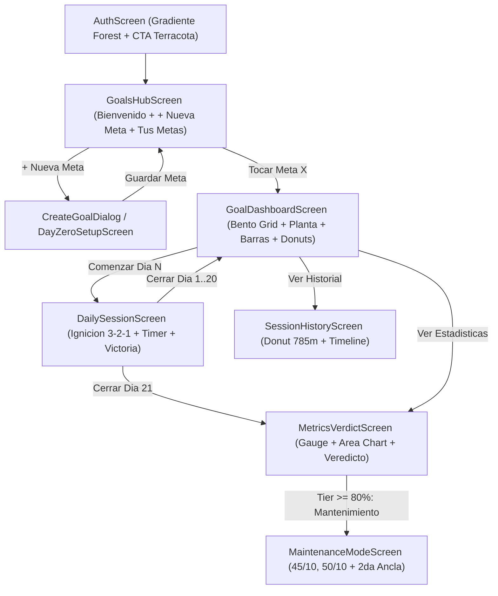

# MATRIZ DE ORQUESTACION UI: Botanical FinTech, Multi-Meta e Ingenieria de Dopamina

Codigo anadido por Felipe Denis

> Documento maestro de diseno y ejecucion paso a paso para transformar la interfaz de **HabitFlow Android** hacia una arquitectura visual estilo **Botanical FinTech** (fusionando las 2 imagenes de referencia: paleta **Forest de 30 colores** + layout limpio de 5 vistas), soporte **Multi-Meta** (`Bienvenido` + `Tus Metas` + `+ Nueva Meta`), e **Ingenieria Conductual / Dopamina Etica** para procrastinadores, bajo filosofia **Data-Driven, Black Box y Modularidad Absoluta**.

---

## Contrato de Diseno y Restricciones No Negociables

1. **Cero Java y Cero Groovy:** 100% Kotlin + Jetpack Compose Material 3 + Gradle Kotlin DSL.
2. **Modularidad Absoluta y Black Box:**
   - Los nodos visuales (`ui/`) nunca contienen logica matematica, de dopamina, ni llamadas directas a Firebase; solo consumen `StateFlow` y emiten acciones hacia ViewModels / UseCases.
   - Los graficos estadisticos y la planta evolutiva viven aislados como nodos visuales puros en `ui/components/charts/`, `ui/components/plant/` y `ui/components/dopamine/` usando **Jetpack Compose `Canvas` nativo** (sin dependencias externas pesadas de graficas).
   - El motor de dopamina (XP, rangos, escudos, logros y mensajes de refuerzo) es **100% Data-Driven** desde JSON externos en `app/src/main/assets/dopamine/`.
3. **Cero Emojis:** Toda iconografia usa `Material Icons` y dibujo vectorial en `Canvas`.
4. **Firma Obligatoria:** Todo archivo nuevo o modificado debera llevar la firma `Codigo anadido por Felipe Denis`.

---

## Seccion 1: Sistema de Diseno "Botanical FinTech" (Paleta Forest + Referencia Visual)

La interfaz actual es plana y excesivamente sobria. Para generar retencion visual y claridad inmediata sin saturar al procrastinador, combinamos la estructura aireada de tarjetas blancas redondeadas de la referencia UI con los tonos organicos de la paleta **Forest (30 colores)**:

### 1.1 Tokens Semanticos de Color (`ForestPalette.kt`)

| Rol Semantico | Hex Exacto | Origen en Paleta Forest | Uso en la Interfaz |
| :--- | :--- | :--- | :--- |
| **ForestDeepest** | `#172B19` | Fila 3, Verde Abismal | Texto de maximo contraste sobre blanco y gradiente Auth superior |
| **ForestCanopy** | `#224621` | Fila 3, Pino Oscuro | Gradiente de tarjetas Hero y encabezados oscuros |
| **ForestMoss** | `#265D28` | Fila 3, Verde Musgo | Gradiente Auth inferior y bordes de foco |
| **ForestEmerald** | `#39853F` | Fila 4, Verde Activo | Accion primaria positiva, Fase 1, barras activas |
| **ForestVibrant** | `#4BA548` | Fila 4, Hoja Viva | Relleno de progreso completado, confetti botanico, Check 2 |
| **ForestOlive** | `#688D42` | Fila 4, Oliva Calido | Indicadores secundarios de racha y crecimiento |
| **ForestLimeSoft** | `#7FB14E` | Fila 4, Brote Claro | Resaltado de hojas jovenes y badges de XP |
| **ForestSage** | `#78A972` | Fila 4, Salvia | Relleno suave de grafica de area y Fase 2 |
| **ForestMintSoft** | `#92C58A` | Fila 4, Menta Suave | Fondos de chips completados y anillos secundarios |
| **SlatePine** | `#2E403B` | Fila 1, Pizarra Pino | Subtitulos, ejes de graficas y etiquetas tecnicas |
| **TealPine** | `#406260` | Fila 1/2, Verde Azulado | Fase 2 (Resistencia), indicadores de puntualidad |
| **TealMist** | `#53817E` | Fila 2, Bruma Pino | Grafica de barras inactivas y estado secundario |
| **BarkDark** | `#2C2119` | Fila 1, Corteza Oscura | Troncos en `VirtualPlantTerrariumCanvas` |
| **BarkMedium** | `#473528` | Fila 1, Tierra Oscura | Maceta / base de terrario y texto calido |
| **BarkWarm** | `#6C503C` | Fila 1/2, Madera | Detalles organicos y separadores calidos |
| **ClaySoft** | `#A88167` | Fila 2, Arcilla Clara | Estado reversible "Planta necesita riego" tras dia `MISSED` |
| **TerracottaAction** | `#B86931` | Fila 2, Terracota | CTA de alto contraste en Auth, bloque `DESCANSO` y alertas |
| **OchreWarm** | `#9A572A` | Fila 1/2, Ocre | Medalla de Escudo de Racha y acento Fase 3 |
| **CanvasMist** | `#F2F7F4` | Derivado aireado de Forest | Fondo global de pantallas (sustituye gris plano) |
| **CardPure** | `#FFFFFF` | Referencia UI FinTech | Tarjetas Bento elevadas con sombra sutil y borde `#DCE8E0` |
| **CardBorderSoft** | `#DCE8E0` | Tinte Salvia 12% | Borde sutil `1.dp` de tarjetas limpias |

### 1.2 Geometria, Superficies y Jerarquia Visual (Referencia UI)

- **Tarjetas Bento (`CardPure`):** Esquinas `20.dp`, borde `1.dp` (`CardBorderSoft`), elevacion sutil `2.dp`, padding interno `16.dp`.
- **Botones e Inputs Tipo Pildora (Pantalla Auth):** Esquinas `28.dp`, altura minima `52.dp`, inputs blancos puros sobre gradiente `ForestDeepest -> ForestEmerald`, boton CTA principal en `TerracottaAction` (`#B86931`) con texto blanco para provocar contraste inmediato (replica exacta de la Pantalla 1 de la referencia).
- **Tipografia Tabular (`tnum`):** Obligatoria en contadores `MM:SS`, XP (`+15 XP`), rachas y KPIs para evitar saltos horizontales.
- **Contraste WCAG:** Texto sobre `CardPure` siempre en `ForestDeepest` (`#172B19`) o `SlatePine` (`#2E403B`). Texto sobre `TerracottaAction` o `ForestCanopy` siempre en `#FFFFFF`.

---

## Seccion 2: Ingenieria Conductual y Motor de Dopamina para Procrastinadores

Base neurocientifica y psicologica extraida de los 3 papers de referencia en el workspace:
- **Wolfram Schultz (2016, PMC4826767 — Dopamine Reward Prediction Error):** Las neuronas dopaminergicas codifican `RPE = Recompensa Recibida - Predicha`. Un RPE positivo dispara aprendizaje conductual y refuerza la accion; un RPE negativo suprime la conducta. Por ello el sistema aplica **Bono Sorpresa RPE Positivo** (+15 XP con 30% de probabilidad al cerrar el dia) y condicionamiento inmediato en el disparador (`+10 XP` al iniciar), evitando cualquier penalizacion negativa de XP.
- **Sirois & Pychyl (2013, Compass — Short-Term Mood Regulation):** La procrastinacion no es falla de gestion de tiempo, sino **priorizacion de regulacion emocional a corto plazo** frente a tareas aversivas y culpa (`r = -0.31` con autocompasion). Por ello la planta entra en estado **Cero Culpa** (`NEEDS_WATER` en arcilla `#A88167`, nunca muerta) y existe el **Bono Fenix (+20 XP)** por retomar tras fallar un dia.
- **Piers Steel (2007, Meta-analisis de 691 correlaciones — Temporal Motivation Theory):** `Utilidad = (Expectativa x Valor) / (1 + Impulsividad x Demora)`. Limitar a **maximo 3 metas activas** protege la Expectativa; las micro-recompensas escalonadas colapsan la Demora; el diseno Forest + apodo elevan el Valor; y los recordatorios en `triggerTime` reducen la Impulsividad.

Un procrastinador no evita una tarea por pereza racional, sino por **regulacion emocional ante la friccion inicial** (miedo al tamano de la tarea, perfeccionismo o recompensa lejana). Si una app exige trabajar 50 minutos antes de entregar la primera recompensa visual, el cerebro procrastinador abandona antes de empezar.

Este sistema aplica **7 mecanismos de ingenieria conductual** aislados como cajas negras Data-Driven:

### Mecanismo 1: Ignicion Cero-Friccion (Regla de 3-2-1 + XP por Solo Empezar)
- **Por que funciona:** El 80% de la procrastinacion ocurre en los primeros 60 segundos antes de pulsar "Iniciar". Premiar el arranque rompe la paralisis de inicio.
- **Implementacion:**
  - Al pulsar **"Comenzar Dia X"**, un overlay compacto de 3 segundos (`IgnitionCountdownOverlay`: `3 -> 2 -> 1 -> En marcha`) prepara la transicion psicologica y fija el entorno.
  - Al iniciar el primer segundo del temporizador dentro de la ventana de puntualidad (`<= 10m` o `<= 5m` en Dia 9), el sistema otorga inmediatamente **`+10 XP (Bono de Arranque Puntual)`** con un micro-banner y vibracion suave.

### Mecanismo 2: Micro-Dopamina Escalonada por Check + Feedback Sensorial (`HapticAndToneController`)
- **Por que funciona:** Fragmenta una sesion larga en micro-victorias frecuentes (dopamina anticipatoria y de cierre).
- **Implementacion:**
  - **Check 1 (Preparacion):** Vibracion tactil sutil (`HapticFeedbackType.TextHandleMove`) + pill `+5 XP`.
  - **Mitad de bloque FOCUS (50%):** Mensaje alentador no intrusivo desde `feedback_catalog.json` (ej. *"Mitad superada. Ya rompiste la resistencia inicial."*).
  - **Transicion `FOCUS -> BREAK`:** Tono calido + cambio de color suave a `TerracottaAction` / `AmberSoft`.
  - **Check 2 (`00:00` completado):** Dispara `BotanicalConfettiOverlay` (hojas y particulas en Compose `Canvas` en tonos `ForestEmerald`, `ForestVibrant`, `LimeSoft` y `TerracottaAction`) + `+25 XP` base + bono por minuto enfocado.
  - **Finalizar Dia (Check 3):** Muestra `DailyVictoryDialog` con resumen animado de XP ganado, avance de la planta, racha actualizada y logro desbloqueado (si aplica).

### Mecanismo 3: Aversion a la Perdida Recuperable (Planta Viva vs Necesita Riego + Escudo de Racha)
- **Por que funciona:** La muerte permanente de una racha o planta genera efecto "que mas da" (*what-the-hell effect*) y abandono definitivo. La perdida debe doler un poco, pero ser **100% recuperable**.
- **Implementacion:**
  - Si hay dias `MISSED` recientes y el dia actual aun no se completa, la planta en `VirtualPlantTerrariumCanvas` pasa a estado visual `NEEDS_WATER` (hojas levemente caidas y tinte `ClaySoft` `#A88167` con indicador *"Necesita riego hoy"*).
  - Al completar la sesion del dia, ocurre una animacion de restauracion (*"Planta hidratada"*) y regresa al verde `ForestVibrant`.
  - **Escudo de Racha (`streakShields`):** Cada 5 dias completados consecutivos, el usuario gana `1` Escudo de Racha (maximo 2 acumulados) que protege automaticamente la racha ante 1 dia omitido.

### Mecanismo 4: XP, Rangos Botanicos y Logros Data-Driven (`assets/dopamine/`)
- **Por que funciona:** Convierte minutos aburridos en identidad progresiva visible y metas secundarias sorprendentes.
- **Rangos Botanicos (6 niveles):**
  1. `0 - 99 XP`: **Semilla Latente**
  2. `100 - 299 XP`: **Brote Constante**
  3. `300 - 599 XP`: **Tallo Firme**
  4. `600 - 999 XP`: **Copa en Flor**
  5. `1000 - 1499 XP`: **Roble Autonomo**
  6. `1500+ XP`: **Guardian del Bosque**
- **Catalogo Data-Driven `assets/dopamine/achievements_catalog.json` (ejemplos clave):**
  - `first_spark` (*Primera Chispa*): Completar el Dia 1 (5 min).
  - `punctual_sniper` (*Precision Quirurgica*): Superar el Dia 9 en ventana <= 5 min.
  - `phoenix_return` (*Efecto Fenix*): Completar una sesion inmediatamente despues de un dia `MISSED` (premia volver tras fallar, atacando directo al abandono).
  - `week_one_survivor` (*Inercia Rota*): Completar los 7 dias de la Fase 1.
  - `deep_diver` (*Inmersion Profunda*): Completar 40 min continuos sin pausa (Dia 15).
  - `sprint_master` (*Habito Instalado*): Alcanzar >= 80% al cierre del Dia 21.

### Mecanismo 5: Efecto Zeigarnik Visual (Continuidad Inconclusa)
- **Por que funciona:** El cerebro recuerda mejor una tarea iniciada o acotada en una micro-frase concreta que una obligacion abstracta.
- **Implementacion:** La tarjeta Hero del Dashboard muestra en primer plano la micro-tarea escrita al cerrar ayer (`nextMicroTask`), acompañada de una barra visual de *"1 paso pendiente para hoy"*.

### Mecanismo 6: Disparadores Horarios Reales (`ReminderScheduler`)
- **Por que funciona:** Sin disparador externo, el procrastinador olvida su `triggerTime` hasta que ya es tarde.
- **Implementacion:** Al guardar o editar una meta, `AlarmManager` / `WorkManager` programa dos notificaciones locales exactas para cada meta activa:
  - `triggerTime - 2 min`: *"En 2 minutos inicia tu bloque de [Tarea Ancla]. Prepara tu espacio: [triggerLocation]."*
  - `triggerTime`: *"Hora de inicio. Solo 5 minutos para romper la inercia."* con accion directa para abrir la meta.

### Mecanismo 7: Guardia Anti-Procrastinacion en Multi-Meta
- **Por que funciona:** Los procrastinadores suelen caer en *"procrastinacion productiva"*: crear 8 metas nuevas en lugar de ejecutar 1.
- **Implementacion:** El Hub `Tus Metas` permite crear multiples metas con el boton superior **`+ Nueva Meta`**, pero muestra claramente un indicador de carga cognitiva (recomendado maximo 2 o 3 metas en estado `ACTIVE` simultaneamente; el usuario puede pausar una meta o marcar nuevas metas como `PAUSED` / `QUEUED` sin perder datos).

### 2.1 Esquema de Catalogos JSON en `app/src/main/assets/dopamine/`

**`assets/dopamine/feedback_catalog.json`:**
```json
{
  "version": "1.0",
  "xpRules": {
    "prepCheckXp": 5,
    "punctualStartXp": 10,
    "dayCompletionBaseXp": 25,
    "xpPerFocusMinute": 1,
    "phoenixRecoveryBonusXp": 20,
    "streakDaysPerShield": 5,
    "maxShields": 2
  },
  "ranks": [
    { "minXp": 0, "title": "Semilla Latente" },
    { "minXp": 100, "title": "Brote Constante" },
    { "minXp": 300, "title": "Tallo Firme" },
    { "minXp": 600, "title": "Copa en Flor" },
    { "minXp": 1000, "title": "Roble Autonomo" },
    { "minXp": 1500, "title": "Guardian del Bosque" }
  ],
  "messages": {
    "onPunctualStart": [
      "Arranque puntual registrado. El 80% de la batalla ya esta ganada.",
      "Cero retraso. Tu cerebro acaba de superar la friccion inicial."
    ],
    "onMidBlock": [
      "Mitad del bloque superada. Manten una sola ventana y sigue.",
      "El impulso ya esta en marcha. No rompas el ritmo ahora."
    ],
    "onRecoveryAfterMiss": [
      "Volviste tras una pausa. Retomar hoy vale doble para tu habito.",
      "Efecto Fenix activado: no abandonaste el sprint."
    ]
  }
}
```

---

## Seccion 3: Arquitectura Multi-Meta ("Bienvenido / Tus Metas") y Esquema Firestore

### 3.1 Nuevo Flujo de Navegacion (Alineado a las 5 Pantallas de Referencia)



### 3.2 Evolucion del Esquema Cloud Firestore (`users/{uid}/goals/{goalId}`)

Para soportar multiples metas autogeneradas sin romper el aislamiento por `uid` ni perder datos previos:

```text
users/{uid}                                     (Perfil global y economia de dopamina)
  ├── uid: String
  ├── email: String
  ├── displayName: String                       (Usado en "Bienvenido, [displayName]")
  ├── totalXp: Int
  ├── currentRank: String
  ├── globalStreak: Int
  ├── bestStreak: Int
  ├── streakShields: Int
  ├── unlockedAchievements: List<String>
  ├── migratedToMultiGoal: Boolean
  ├── updatedAt: Timestamp
  │
  └── goals/{goalId}                            (Cada meta independiente creada por el usuario)
        ├── goalId: String
        ├── title: String                       (Nombre corto de la meta, ej. "Proyecto Kotlin")
        ├── anchorTask: String                  (Parametro Dia 0)
        ├── secondaryAnchorTask: String?
        ├── triggerTime: String                 ("HH:mm")
        ├── triggerLocation: String
        ├── blockingRule: String
        ├── status: String                      ("ACTIVE", "PAUSED", "MAINTENANCE", "COMPLETED")
        ├── sprintStartDateIso: String
        ├── currentDay: Int                     (1..21)
        ├── completedDays: List<Int>
        ├── missedDays: List<Int>
        ├── nextMicroTask: String
        ├── durationFactor: Double
        ├── inMaintenanceMode: Boolean
        ├── maintenanceUnlocked: Boolean
        ├── activeRepeatRangeStart: Int?
        ├── cycleNumber: Int
        ├── goalStreak: Int
        ├── createdAt: Timestamp
        ├── updatedAt: Timestamp
        │
        ├── dailyLogs/{dayNumber}
        ├── maintenanceSessions/{sessionId}
        └── sprintHistory/{cycleId}
```

#### Estrategia de Migracion Sin Perdida
Al observar `users/{uid}` por primera vez tras esta actualizacion:
- Si `users/{uid}` tiene `setupCompleted == true` y `migratedToMultiGoal != true`, el repositorio ejecuta un `WriteBatch` unico que copia el sprint existente a `users/{uid}/goals/goal_primary` (junto con sus `dailyLogs`, `maintenanceSessions` y `sprintHistory`) y marca `migratedToMultiGoal = true`. Asi ningun usuario pierde progreso previo.

#### Actualizacion Obligatoria en `firestore.rules`
Anadir regla explicita para la subcoleccion `goals/{goalId}` y sus subcolecciones bajo `isOwner(userId)`:
```javascript
match /goals/{goalId} {
  allow read, write: if isOwner(userId);
  match /dailyLogs/{dayId} { allow read, write: if isOwner(userId); }
  match /maintenanceSessions/{sessionId} { allow read, write: if isOwner(userId); }
  match /sprintHistory/{cycleId} { allow read, write: if isOwner(userId); }
}
```

### 3.3 Arbol de Carpetas Aisladas a Crear / Actualizar

```text
app/src/main/
├── assets/
│   ├── plans/anti_procrastination_21d.json
│   └── dopamine/
│       ├── feedback_catalog.json               <-- [NUEVO] Reglas de XP, rangos y mensajes
│       └── achievements_catalog.json           <-- [NUEVO] Catalogo de logros conductuales
└── java/com/utdevs/habitflow/
    ├── domain/
    │   ├── model/                              (Agregar GoalSummary, UserProfile, DopamineModels)
    │   ├── repository/                         (Agregar GoalsRepository, DopamineCatalogSource)
    │   └── dopamine/                           <-- [NUEVO] Cajas negras puras de dopamina
    │       ├── ComputeXpAndRankUseCase.kt
    │       ├── EvaluateAchievementsUseCase.kt
    │       ├── EvaluatePlantHealthUseCase.kt
    │       └── SelectFeedbackMessageUseCase.kt
    ├── data/
    │   ├── dopamine/                           <-- [NUEVO] AssetDopamineCatalogSource.kt
    │   ├── feedback/                           <-- [NUEVO] HapticAndToneController.kt
    │   └── reminder/                           <-- [NUEVO] GoalReminderScheduler.kt
    └── ui/
        ├── theme/                              (ForestPalette.kt, Theme.kt renovado)
        ├── components/                         <-- [NUEVO] Nodos visuales aislados reutilizables
        │   ├── charts/
        │   │   ├── WeeklyBarChartCanvas.kt
        │   │   ├── FocusAreaChartCanvas.kt
        │   │   ├── PhaseDonutChartCanvas.kt
        │   │   └── VerdictGaugeCanvas.kt
        │   ├── plant/
        │   │   └── VirtualPlantTerrariumCanvas.kt
        │   └── dopamine/
        │       ├── IgnitionCountdownOverlay.kt
        │       ├── BotanicalConfettiOverlay.kt
        │       ├── XpBadgePill.kt
        │       └── DailyVictoryDialog.kt
        ├── home/                               <-- [NUEVO] Pantalla Hub "Bienvenido + Tus Metas"
        │   ├── GoalsHubViewModel.kt
        │   ├── GoalsHubScreen.kt
        │   └── CreateGoalDialog.kt
        ├── history/                            <-- [NUEVO] Pantalla Historial (Donut 785m + Timeline)
        │   ├── SessionHistoryViewModel.kt
        │   └── SessionHistoryScreen.kt
        ├── auth/                               (Redisenado a Pantalla 1 Referencia)
        ├── dashboard/                          (Redisenado a Bento Grid Pantalla 3)
        ├── session/                            (Integrado con Ignicion + Micro-dopamina + Victoria)
        └── metrics/                            (Redisenado a Gauge + Area Chart Pantalla 4)
```

---

## Seccion 4: Matriz Maestra de Ejecucion Paso a Paso (Fase UI-0 a Fase UI-7)

| Fase | Modulo / Objetivo | Artefactos Clave | Dependencias | Compuerta de Verificacion (DoD) |
| :--- | :--- | :--- | :--- | :--- |
| **Fase UI-0** | Design System Forest + Auth FinTech | `ForestPalette.kt`, `Theme.kt`, `AuthScreen.kt` | Ninguna | Compila y Auth replica gradiente verde + inputs pildora + CTA terracota |
| **Fase UI-1** | Dominio & Firestore Multi-Meta + Perfil | `GoalModels`, `GoalsRepository`, `FirestoreMappers`, `firestore.rules`, `AuthUser.displayName` | Fase UI-0 | CRUD multi-meta en `users/{uid}/goals/{goalId}` + migracion sin perdida |
| **Fase UI-2** | Hub "Bienvenido / Tus Metas / + Nueva Meta" | `GoalsHubViewModel.kt`, `GoalsHubScreen.kt`, `CreateGoalDialog.kt`, `HabitFlowNavGraph.kt` | Fase UI-1 | Saludo con nombre, boton superior `+ Nueva Meta`, tarjetas autogeneradas por meta |
| **Fase UI-3** | Motor de Dopamina Data-Driven | `assets/dopamine/*.json`, `domain/dopamine/*`, `AssetDopamineCatalogSource.kt`, `HapticAndToneController.kt` | Fase UI-1 | Tests JVM 100% verdes (XP, rangos, escudos, logro Fenix, salud planta) |
| **Fase UI-4** | Nodos Canvas (Graficas + Terrario Vivo) | `WeeklyBarChartCanvas`, `FocusAreaChartCanvas`, `PhaseDonutChartCanvas`, `VerdictGaugeCanvas`, `VirtualPlantTerrariumCanvas` | Fase UI-0 | Preview/render limpio de 4 graficas y planta viva vs necesita riego |
| **Fase UI-5** | Bento Dashboard de Meta + Sesion Dopamina | `DashboardScreen.kt`, `DailySessionScreen.kt`, `IgnitionCountdownOverlay`, `BotanicalConfettiOverlay`, `DailyVictoryDialog` | Fases UI-2, UI-3, UI-4 | Flujo completo: Ignicion -> Checks con XP/haptica -> Confetti -> Victoria |
| **Fase UI-6** | Estadisticas Gauge/Area + Historial Donut/Timeline | `MetricsVerdictScreen.kt`, `SessionHistoryScreen.kt`, `SessionHistoryViewModel.kt` | Fases UI-4, UI-5 | Gauge 0-100%, area chart 5->80m y donut 785m renderizan datos reales |
| **Fase UI-7** | Recordatorios Reales, Auditoria y Despliegue ADB | `GoalReminderScheduler.kt`, `AndroidManifest.xml`, auditoria signos/emojis, APK en dispositivo | Fases UI-0..6 | `testDebugUnitTest assembleDebug`, 0 Java, 0 emojis, firma `Felipe Denis` |

### Detalle Paso a Paso por Fase

#### Fase UI-0: Design System "Botanical FinTech" y Rediseño de `AuthScreen`
1. Crear `ui/theme/ForestPalette.kt` con los 21 tokens semanticos extraidos de la paleta Forest.
2. Actualizar `ui/theme/Theme.kt` y `ui/theme/Type.kt` (superficies `CanvasMist` `#F2F7F4`, primario `ForestEmerald` `#39853F`, acento secundario `TerracottaAction` `#B86931`, texto `ForestDeepest` `#172B19`).
3. Actualizar `ui/auth/AuthScreen.kt` imitando la Pantalla 1 de la referencia visual: fondo completo en gradiente vertical `ForestDeepest -> ForestEmerald`, logotipo geometrico vectorial botanico dentro de circulo traslucido, tarjeta/inputs blancos pildora (`28.dp`), chips de selector (`Correo` / `Telefono SMS`), boton primario en `TerracottaAction` (`#B86931`) y boton secundario limpio para Google.
- **Prompt sugerido:** *"Ejecuta Fase UI-0 segun MATRIZ_UI_DOPAMINA_METAS.md, aislando tokens en ForestPalette.kt y redisenando AuthScreen con firma de Felipe Denis."*

#### Fase UI-1: Evolucion Multi-Meta en Dominio, `AuthUser.displayName` y Firestore
1. Extender `AuthUser` con `displayName: String` (extraido de `FirebaseUser.displayName` o prefijo de correo si es nulo) y actualizar `FirebaseAuthRepository`.
2. Crear modelos en `domain/model/`: `UserProfile` (XP, rango, `globalStreak`, `streakShields`, `unlockedAchievements`), `GoalSprint` (incluye `goalId`, `title`, `status`, y campos del sprint de 21 dias).
3. Implementar `FirestoreGoalsRepository` bajo `users/{uid}/goals/{goalId}` con migracion automatica desde el documento legacy `users/{uid}` hacia `goal_primary`.
4. Actualizar `firestore.rules` y `AppContainer.kt`.
- **Prompt sugerido:** *"Ejecuta Fase UI-1 segun MATRIZ_UI_DOPAMINA_METAS.md para soportar multiples metas en users/{uid}/goals/{goalId} con migracion automatica y displayName."*

#### Fase UI-2: Pantalla Hub `"Bienvenido / Tus Metas"` y Boton Superior `+ Nueva Meta`
1. Crear `ui/home/GoalsHubViewModel.kt`, `ui/home/GoalsHubScreen.kt` y `ui/home/CreateGoalDialog.kt`.
2. Estructura vertical de `GoalsHubScreen`:
   - **Header de Bienvenida:** `"Bienvenido, [displayName]"` + subtítulo de rango botanico (`Semilla Latente` .. `Guardian del Bosque`), XP acumulado y contador de racha + escudos.
   - **Boton Prominente Arriba del Todo:** Boton ancho estilo pildora en `TerracottaAction` / `ForestEmerald` con texto **`+ Nueva Meta`** (abre `CreateGoalDialog` para registrar `Titulo de la Meta` + los 4 parametros del Dia 0).
   - **Seccion `"Tus Metas"` (Botones / Tarjetas Autogenerables):** Lista generada dinamicamente desde Firestore (`items(goals)`). Cada tarjeta muestra nombre de la meta, `Dia X / 21`, anillo circular de progreso, estado (`Activa`, `En Pausa`, `Mantenimiento`), micro-tarea pendiente y boton directo para abrir esa meta.
   - **Guardia Anti-Procrastinacion:** Si hay >= 3 metas en estado `ACTIVE`, muestra aviso constructivo recomendando pausar una o completarla antes de dispersar el foco (permitiendo elegir `Pausar otra` o `Activar de todos modos`).
3. Actualizar `HabitFlowNavGraph.kt` para que la pantalla inicial tras login sea `GoalsHubScreen` (`Routes.GOALS_HUB`), pasando `goalId` a `GoalDashboard`, `DailySession`, `MetricsVerdict` y `SessionHistory`.
- **Prompt sugerido:** *"Ejecuta Fase UI-2 segun MATRIZ_UI_DOPAMINA_METAS.md creando GoalsHubScreen con Bienvenido, boton superior + Nueva Meta y tarjetas autogenerables de Tus Metas."*

#### Fase UI-3: Motor de Dopamina Data-Driven y Controlador Sensorial
1. Crear `app/src/main/assets/dopamine/feedback_catalog.json` y `achievements_catalog.json`.
2. Crear `data/dopamine/AssetDopamineCatalogSource.kt` para parsear ambos JSON como caja negra.
3. Crear los 4 casos de uso puros en `domain/dopamine/`:
   - `ComputeXpAndRankUseCase.kt` (suma XP por checks/puntualidad/minutos/Fenix y calcula rango + escudos).
   - `EvaluateAchievementsUseCase.kt` (detecta nuevos logros desbloqueados sin duplicar).
   - `EvaluatePlantHealthUseCase.kt` (calcula `PlantHealthState`: `THRIVING`, `NEEDS_WATER` tras dia omitido, `RESTORED`).
   - `SelectFeedbackMessageUseCase.kt` (elige mensaje motivacional contextual).
4. Crear `data/feedback/HapticAndToneController.kt` (caja negra para vibraciones diferenciadas y tonos suaves con opcion de silenciar).
5. Agregar tests unitarios JVM en `app/src/test/java/com/utdevs/habitflow/domain/dopamine/`.
- **Prompt sugerido:** *"Ejecuta Fase UI-3 segun MATRIZ_UI_DOPAMINA_METAS.md implementando el motor Data-Driven de dopamina, logros y tests unitarios."*

#### Fase UI-4: Nodos de Assets y Graficas Canvas (`ui/components/`)
Construir 5 componentes Canvas puros y aislados (cada uno recibe datos simples y colores de `ForestPalette`, cero dependencias de ViewModel):
1. `WeeklyBarChartCanvas.kt`: 7 barras verticales (L..D o Dias de la fase actual) con esquinas redondeadas superiores y resaltado en `ForestVibrant` para dias completados y `TealMist` para pendientes (referencia Pantalla 3).
2. `FocusAreaChartCanvas.kt`: Curva Bezier suave con relleno degradado traslucido verde sobre eje horizontal para mostrar la evolucion diaria de minutos enfocados (`5m -> 80m`, referencia Pantalla 4).
3. `PhaseDonutChartCanvas.kt`: Anillo donut segmentado en 3 arcos proporcionales a la meta de `785 min` (Fase 1 `115m` `#4BA548`, Fase 2 `295m` `#406260`, Fase 3 `375m` `#B86931`) con total central (referencia Pantalla 5).
4. `VerdictGaugeCanvas.kt`: Medidor semicircular 180 grados con 3 zonas (`0-49% Clay/Terracotta`, `50-79% TealPine`, `80-100% ForestVibrant`) y aguja animada apuntando al `%` actual (referencia Pantalla 4).
5. `VirtualPlantTerrariumCanvas.kt`: Evolucion del Canvas actual de la planta con soporte de `PlantHealthState` (`THRIVING` vs `NEEDS_WATER` en tono `ClaySoft` `#A88167` con gota/indicador de riego pendiente).
- **Prompt sugerido:** *"Ejecuta Fase UI-4 segun MATRIZ_UI_DOPAMINA_METAS.md creando los 5 nodos Canvas aislados en ui/components/charts/ y ui/components/plant/."*

#### Fase UI-5: Rediseño del Dashboard de Meta (Bento Grid) y Sesion con Dopamina
1. Rediseñar `DashboardScreen.kt` (ahora por `goalId`) siguiendo la Pantalla 3 de la referencia:
   - Top bar con regreso a `Tus Metas`, acceso a `Estadisticas`, `Historial` y `Modo Demo`.
   - Fila superior Bento 2 columnas: Izquierda KPI blanco (`Minutos Enfocados` + XP de esta meta); Derecha tarjeta gradiente bosque (`ForestCanopy -> ForestEmerald`) con `"Micro-tarea para hoy"` (Efecto Zeigarnik) y boton `"Comenzar Dia X"`.
   - Terrario vivo `VirtualPlantTerrariumCanvas` + barra de progreso.
   - Tarjeta `WeeklyBarChartCanvas` con progreso semanal.
   - Fila inferior 2 columnas con mini-donuts: `Puntualidad %` y `Cumplimiento %`.
   - Cuadricula limpia de los 21 dias por fases (colores Forest).
2. Mejorar `DailySessionScreen.kt` integrando `IgnitionCountdownOverlay`, feedback sensorial por Check, `+10 XP` al iniciar puntual, `BotanicalConfettiOverlay` al llegar a `00:00` y `DailyVictoryDialog` al finalizar dia.
- **Prompt sugerido:** *"Ejecuta Fase UI-5 segun MATRIZ_UI_DOPAMINA_METAS.md redisenando DashboardScreen en Bento Grid e integrando los overlays de dopamina en DailySessionScreen."*

#### Fase UI-6: Rediseño de Estadisticas (`MetricsVerdictScreen`) y Nueva Pantalla `SessionHistoryScreen`
1. Rediseñar `MetricsVerdictScreen.kt` (estilo Pantalla 4): encabezado con `VerdictGaugeCanvas`, tarjeta de `FocusAreaChartCanvas` (curva 5m -> 80m), tabla comparativa semanal y tarjeta de Veredicto del Dia 21.
2. Crear `ui/history/SessionHistoryViewModel.kt` y `ui/history/SessionHistoryScreen.kt` (estilo Pantalla 5): grafica `PhaseDonutChartCanvas` (`785 min`) arriba y lista cronologica de sesiones (`dailyLogs` + auditorias semanales + calificacion 1-5 + micro-tareas escritas).
- **Prompt sugerido:** *"Ejecuta Fase UI-6 segun MATRIZ_UI_DOPAMINA_METAS.md redisenando MetricsVerdictScreen e implementando SessionHistoryScreen."*

#### Fase UI-7: Recordatorios Horarios, Auditoria Final y Despliegue ADB
1. Crear `data/reminder/GoalReminderScheduler.kt` con `AlarmManager` / `BroadcastReceiver` para disparar notificaciones a `triggerTime - 2 min` y `triggerTime` exacto (respetando permiso `POST_NOTIFICATIONS` ya declarado).
2. Ejecutar auditoria automatica: 0 archivos `.java`, 0 emojis, 100% archivos firmados `Felipe Denis`, `./gradlew testDebugUnitTest assembleDebug` verde.
3. Instalar en dispositivo conectado por ADB y probar el flujo completo: Login -> Hub `"Bienvenido / Tus Metas"` -> `+ Nueva Meta` -> Dashboard Bento -> Sesion con Ignicion + Confetti + Victoria -> Estadisticas Gauge -> Historial Donut.
- **Prompt sugerido:** *"Ejecuta Fase UI-7 segun MATRIZ_UI_DOPAMINA_METAS.md agregando GoalReminderScheduler, ejecutando auditoria y desplegando por ADB."*

---

## Seccion 5: Decisiones Abiertas para Calibrar con Denis Antes de Codificar

Antes de iniciar la **Fase UI-0**, confirma estos 3 puntos operativos para no asumir preferencias no pedidas:

1. **Limite de Metas Activas Simultaneas (Guardia Anti-Procrastinacion):**
   ¿Quieres que el Hub `Tus Metas` permita tener metas ilimitadas activas al mismo tiempo, o aplicamos un tope saludable configurable (por ejemplo, maximo **2 o 3 metas activas** simultaneas y el resto en estado `En Pausa / Cola` hasta avanzar una)?
2. **Nombre en el Saludo `"Bienvenido, [Nombre]"`:**
   ¿Tomamos el nombre automaticamente de Google Sign-In / prefijo del correo permitiendo editarlo desde un boton de perfil en el Hub, o pedimos el nombre/apodo la primera vez que entra?
3. **Intensidad Sensorial (Audio y Vibracion de Dopamina):**
   ¿Mantenemos tono sutil + vibracion tactil corta en Check 1, mitad de bloque y victoria (con interruptor `Modo Silencio` en el Hub), o prefieres solo vibracion sin sonido por defecto?
