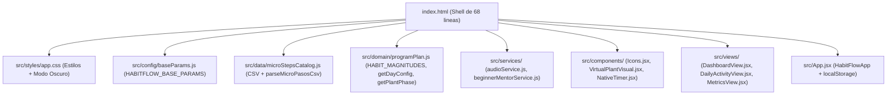

# Documentacion Tecnica: Arquitectura Modular Black Box de HabitFlow Web

Esta guia describe de forma fiel y verificable la estructura modular **Black Box** de **HabitFlow Web** (`main`), donde cada responsabilidad vive aislada en su propio modulo documentado bajo `src/`, mientras `index.html` actua unicamente como shell de ensamblaje.

---

## 1. Arquitectura Modular Black Box y Stack Tecnologico

La aplicacion se ejecuta directamente en el navegador usando React 18, Tailwind CSS y Babel Standalone via CDN (sin requerir `npm install` ni bundler), organizada en capas independientes con contratos explicitos sobre `window`:

---

## 2. Mapa Exacto de Modulos (`src/`)

| Modulo | Capa | Contrato / Responsabilidad Black Box |
|:---|:---|:---|
| `index.html` | Entrada | Shell HTML (68 lineas): carga CDNs, `src/styles/app.css` y ordena la carga de modulos JS y JSX. |
| `src/styles/app.css` | Estilos | Tipografia base, scrollbar y overrides de Modo Oscuro mediante `html.dark`. |
| `src/config/baseParams.js` | Configuracion | Expone `HABITFLOW_BASE_PARAMS` (`TOTAL_DAYS`, `DEFAULT_HABIT`, `DEFAULT_MAGNITUDE`, `PUNCTUALITY_WINDOW_MINUTES`, `DURATIONS`). |
| `src/domain/programPlan.js` | Dominio | Funciones puras: `HABIT_MAGNITUDES`, `PROGRAM_STAGES`, `getDayConfig(dayNum, magnitude)` y `getPlantPhase(completedDaysCount)`. |
| `src/data/microStepsCatalog.js` | Datos | Catalogo CSV embebido (`EMBEDDED_MICRO_PASOS_CSV`) y parser `parseMicroPasosCsv(csvText)` para 6 metas simples. |
| `src/services/audioService.js` | Servicio | `playChime()`: sintetizador Web Audio API (587.33 Hz + 880 Hz) sin archivos MP3/WAV. |
| `src/services/beginnerMentorService.js` | Servicio | `BEGINNER_MENTOR_SYSTEM_PROMPT` y `buildBeginnerMentorSuggestion(ctx)` para guia didactica desde cero sin secretos en repo. |
| `src/components/Icons.jsx` | UI Atomica | Set de iconos SVG vectoriales en linea (`Icons`). |
| `src/components/VirtualPlantVisual.jsx` | UI Botanica | Renderizado SVG parametrico en 5 fases (`VirtualPlantVisual`). |
| `src/components/NativeTimer.jsx` | UI Temporizador | Temporizador React (`NativeTimer`) con bloques simples, secuencias multi-fase (Dias 13 y 18) y limpieza de `setInterval`. |
| `src/views/DashboardView.jsx` | Vista 1 | Calendario secuencial de 21 dias en 3 etapas, selector de magnitud, Planta Virtual y tarjeta de proximo paso. |
| `src/views/DailyActivityView.jsx` | Vista 2 | Guia rapida CSV, formularios especificos por dia (1 al 21), temporizador y validacion del 100%. |
| `src/views/MetricsView.jsx` | Vista 3 | Metricas objetivas verificables, tabla cronologica y exportacion JSON. |
| `src/App.jsx` | Orquestador | `HabitFlowApp`: sincronizacion `localStorage` (`habitflow_21days_v2` y `habitflow_dark_mode`), navegacion y montaje en `#root`. |

---

## 3. Persistencia Local (`localStorage`) y Modo Oscuro

1. **`habitflow_21days_v2`** (con migracion automatica desde `habitflow_21days_v1`):
   - Almacena `activeHabit`, `habitMagnitude`, `completedDays`, `currentViewingDay`, `currentView`, `dayData`, `metrics` y `personalPlan`.
2. **`habitflow_dark_mode`**:
   - Almacena `'true'` o `'false'` y aplica la clase `dark` sobre `document.documentElement`.

---

## 4. Reglas de Negocio y Motor de Calibracion

- **Desbloqueo Secuencial (`isDayLocked`):** El Dia `N > 1` permanece bloqueado hasta completar el 100% del Dia `N - 1`.
- **Modo Solo Lectura (`readOnly`):** Los dias en `completedDays` bloquean sus controles para auditoria.
- **3 Calendarios Calibrados (`DURATIONS`):**
  - `chico`: 2 a 10 min/dia (87 min totales).
  - `mediano`: 5 a 23 min/dia (182 min totales).
  - `grande`: 5 a 30 min/dia (257 min totales).
- **Puntualidad Objetiva:** `|Minuto Real - Minuto Programado| <= PUNCTUALITY_WINDOW_MINUTES` (`15` min).

---

## 5. Estructura General del Repositorio

| Archivo / Carpeta | Ubicacion | Estado | Funcion |
|:---|:---|:---|:---|
| `index.html`, `src/` | Raiz | **Activo** | Aplicacion web modular Black Box completa. |
| `start_server.ps1`, `iniciar_habitflow.bat` | Raiz | **Activo** | Servidor HTTP local en PowerShell (puerto 8080, soporte `.jsx` y `.csv`). |
| `LICENSE`, `README.md` | Raiz | **Activo** | Licencia publica GNU GPLv3 y especificacion general. |
| `docs/` | `docs/` | **Documentacion** | Documentacion tecnica, guia de exposicion y PDF con capturas/articulos cientificos. |
| `_archivo_no_usado/` | `_archivo_no_usado/` | **Legado** | Prototipos antiguos (`legacy_7days/`, `test_*.html`, etc.) fuera de ejecucion. |
