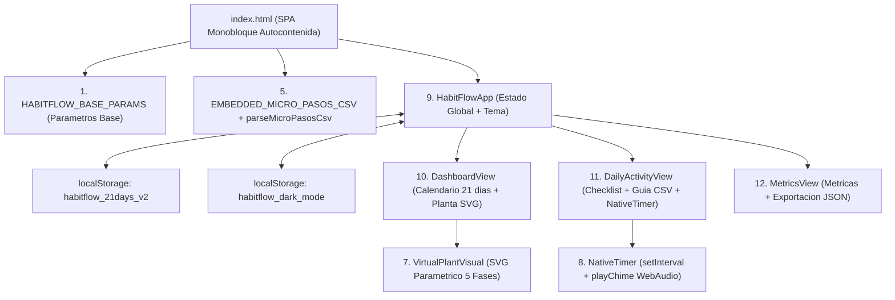

# Documentacion Tecnica: Arquitectura y Funcionamiento de HabitFlow (SPA Monobloque)

Esta guia describe de forma fiel y verificable la estructura real del codigo fuente de **HabitFlow Web** (`index.html`), asi como la separacion de archivos activos, documentacion y codigo legado que ya no interviene en ejecucion.

---

## 1. Arquitectura General y Stack Tecnologico

La aplicacion funciona como una **SPA (Single Page Application) autocontenida en un solo archivo (`index.html`)**. No requiere compilador, bundler ni servidor Node.js: el navegador carga React 18, Tailwind CSS y Babel Standalone desde CDN y transpila el bloque `<script type="text/babel">` en tiempo de ejecucion, lo que permite abrirla tanto mediante servidor local (`start_server.ps1` / `iniciar_habitflow.bat`) como abriendo `index.html` directamente (`file://`).



### Mapa de Secciones dentro de `index.html`

Al inicio de `<script type="text/babel">` se incluye un mapa numerado para localizar cualquier modulo con `Ctrl+F`:

1. `HABITFLOW_BASE_PARAMS`: Parametros base centralizados (`TOTAL_DAYS`, `DEFAULT_HABIT`, `DEFAULT_MAGNITUDE`, `PUNCTUALITY_WINDOW_MINUTES`, `DURATIONS`).
2. `playChime`: Sintetizador de campana con Web Audio API (sin archivos `.mp3` externos).
3. `Icons`: Set de iconos SVG en linea.
4. `HABIT_MAGNITUDES`: Metadatos y tiempos planeados de los 3 calendarios (`chico`, `mediano`, `grande`).
5. `EMBEDDED_MICRO_PASOS_CSV` + `parseMicroPasosCsv`: Catalogo CSV simple embebido para 6 metas cotidianas.
6. `getDayConfig(dayNum, magnitude)`: Selector de duracion diaria y secuencias multi-bloque para los dias 13 y 18.
7. `VirtualPlantVisual`: Renderizado SVG parametrico en 5 fases segun los dias completados.
8. `NativeTimer`: Temporizador con `setInterval`, limpieza de ciclo de vida y timbre al llegar a `00:00`.
9. `HabitFlowApp`: Contenedor principal, persistencia en `localStorage`, modo oscuro y navegacion entre vistas.
10. `DashboardView`: Vista 1 (Calendario de 21 dias en 3 etapas, Planta Virtual y tarjeta de proximo paso).
11. `DailyActivityView`: Vista 2 (Checklist diario, guia CSV opcional, temporizador y cierre del dia).
12. `MetricsView`: Vista 3 (Metricas objetivas verificables y exportacion JSON).

---

## 2. Parametros Base Centralizados (`HABITFLOW_BASE_PARAMS`)

En la seccion 1 de `<script type="text/babel">` viven las constantes principales para facilitar ajustes rapidos sin buscar en el resto del codigo:

```javascript
const HABITFLOW_BASE_PARAMS = {
  TOTAL_DAYS: 21,
  DEFAULT_HABIT: 'Vencer la procrastinacion e iniciar sesiones de estudio efectivas',
  DEFAULT_MAGNITUDE: 'mediano', // 'chico' | 'mediano' | 'grande'
  PUNCTUALITY_WINDOW_MINUTES: 15,
  // Arreglos de 21 numeros: indice 0 = Dia 1 ... indice 20 = Dia 21 (en minutos)
  DURATIONS: {
    chico:   [2, 3, 3, 3, 3, 4, 2,  5, 3,  5,  5,  5,  8, 3,  5,  4, 3, 10,  5, 3, 3],
    mediano: [5, 5, 5, 5, 5, 7, 3,  8, 5, 10,  8, 10, 18, 5, 10,  5, 5, 23, 10, 5, 5],
    grande:  [5, 7, 8, 6, 8, 10, 5, 12, 8, 15, 12, 15, 25, 7, 15, 10, 8, 30, 15, 8, 8]
  }
};
```

- `BASE_PARAMS` enlaza directamente `HABITFLOW_BASE_PARAMS`.
- `getDayConfig(dayNum, magnitude)` consulta `BASE_PARAMS.DURATIONS[validMag][dayNum - 1]` y devuelve el objeto completo del dia (`day`, `stage`, `title`, `purpose`, `actionsCount`, `duration`, `sequence`, `magnitude`).
- En los dias 13 y 18 se inyectan secuencias multi-bloque (trabajo -> descanso -> trabajo) calibradas por magnitud (`4-1-3` / `4-2-4` en `chico`, `10-3-5` / `10-3-10` en `mediano`, `15-3-7` / `12-4-14` en `grande`).

---

## 3. Catalogo CSV Embebido (`EMBEDDED_MICRO_PASOS_CSV`)

Para ofrecer sugerencias concretas sin usar APIs externas ni inteligencia artificial, `index.html` integra un bloque CSV plano con 6 metas comunes (`bajar_de_peso`, `aprender_programacion`, `tocar_instrumento`, `aprender_ingles`, `habito_lectura`, `orden_hogar`):

```javascript
const parseMicroPasosCsv = (csvText) => {
  const lines = (csvText || '').trim().split(/\r?\n/).filter(Boolean);
  if (lines.length <= 1) return [];
  return lines.slice(1).map((line) => {
    const cols = line.split(',').map((c) => c.trim());
    return {
      id: cols[0] || '',
      meta: cols[1] || '',
      steps: cols.slice(2).filter(Boolean)
    };
  }).filter((item) => item.id && item.meta);
};
```

- Al estar embebido en el mismo archivo HTML, evita bloqueos CORS al abrir `index.html` directamente desde el explorador de archivos.
- En `DailyActivityView`, el usuario puede elegir cualquiera de las metas del `<select>` para visualizar sus 4 micro-pasos numerados como referencia rapida.

---

## 4. Persistencia Local (`localStorage`) y Modo Oscuro

La aplicacion usa dos claves independientes en `localStorage`:

1. **`habitflow_21days_v2`** (con migracion desde `habitflow_21days_v1` si existe):
   - Almacena `activeHabit`, `habitMagnitude`, `completedDays`, `currentViewingDay`, `currentView`, `dayData` (respuestas y checklists por dia), `metrics` (`focusMinutes`, `sessionsStarted`, `sessionsCompleted`, `tasksRegisteredCount`, `stepsCompletedCount`, `punctualityLogs`), `featuredNextStep` y `personalPlan`.
2. **`habitflow_dark_mode`**:
   - Almacena `'true'` o `'false'`.
   - Tailwind esta configurado con `darkMode: 'class'`; `HabitFlowApp` aplica `document.documentElement.classList.toggle('dark', darkMode)` y reglas CSS `html.dark ...` para adaptar fondos, bordes, tipografia e inputs mediante el boton `Oscuro` / `Claro` de la barra superior.

---

## 5. Reglas de Negocio y Motor de Evaluacion

### A. Desbloqueo Secuencial (`isDayLocked`)
- El Dia 1 siempre esta disponible.
- Cualquier Dia `N > 1` permanece bloqueado hasta que `N - 1` figure en `appState.completedDays`.

### B. Modo Solo Lectura (`readOnly`)
- Cuando un dia ya esta en `completedDays`, `DailyActivityView` deshabilita entradas y botones de edicion (`disabled={readOnly}`) y muestra el banner protector de consulta.

### C. Porcentaje Diario (`calculateDayCompletion`) y Boton Finalizar
- Cada dia evalua sus acciones requeridas (`actionsCount`) entre `dayData[dayNumber]`.
- El boton `Finalizar Dia` permanece deshabilitado mientras `dayPercentage < 100`.

### D. Evolucion Botanica (`getPlantPhase`)
- **Fase 1 (0 a 3 dias):** Semilla Latente / Germinando.
- **Fase 2 (4 a 7 dias):** Brote Emergente.
- **Fase 3 (8 a 14 dias):** Tallo Firme con Hojas.
- **Fase 4 (15 a 20 dias):** Floracion Radiante.
- **Fase 5 (21 dias):** Arbol Maduro de Estudio.

### E. Temporizador (`NativeTimer`) y Audio (`playChime`)
- Cuenta regresiva con `setInterval(..., 1000)` y limpieza en el `return` del `useEffect` al pausar o desmontar el componente.
- Al llegar a `0`, reproduce dos osciladores sinusoidales (`587.33 Hz` y `880 Hz` a los `150 ms`) con rampa de ganancia exponencial mediante Web Audio API.

---

## 6. Organizacion Real de Carpetas y Archivos

Se separo lo que realmente ejecuta la aplicacion de la documentacion y los prototipos antiguos no utilizados:

| Archivo o Carpeta | Ubicacion | Estado | Funcion |
|:---|:---|:---|:---|
| `index.html` | Raiz del proyecto | **Activo** | SPA monobloque completa (UI, estado, CSV, parametros base y modo oscuro). |
| `start_server.ps1` | Raiz del proyecto | **Activo (opcional)** | Servidor HTTP ligero en PowerShell (`http://localhost:8080/`). |
| `iniciar_habitflow.bat` | Raiz del proyecto | **Activo (opcional)** | Lanzador directo en Windows (`index.html` o servidor en puerto 8080). |
| `README.md` | Raiz del proyecto | **Documentacion** | Especificacion funcional general del programa de 21 dias. |
| `EXPLICACION_TECNICA_DEL_CODIGO.md` | `docs/` | **Documentacion** | Arquitectura tecnica real y mapa de secciones de `index.html`. |
| `GUIA_EXPLICATIVA_PROFESOR.md` | `docs/` | **Documentacion** | Dossier de exposicion, tabla de magnitudes y guia de cambios en vivo. |
| `legacy_7days/` | `_archivo_no_usado/` | **Inactivo / Legado** | Prototipo inicial de 7 dias separado en multiples `.js`; no se carga en `index.html`. |
| `src/` | `_archivo_no_usado/` | **Inactivo / Legado** | Archivo `programDays.js` de una refactorizacion anterior no importada por `index.html`. |
| `css/` | `_archivo_no_usado/` | **Inactivo / Legado** | Hoja `styles.css` antigua; los estilos activos viven en `index.html` y Tailwind CDN. |
| `assets/` | `_archivo_no_usado/` | **Inactivo / Legado** | Recursos estaticos no referenciados por la SPA monobloque. |
| `package.json` | `_archivo_no_usado/` | **Inactivo / Legado** | Manifiesto Vite de referencia; no existe build ni `node_modules` activo. |
| `test_21days.html`, `test_habitflow.html` | `_archivo_no_usado/` | **Inactivo / Legado** | Bancos manuales antiguos de prueba en navegador. |
